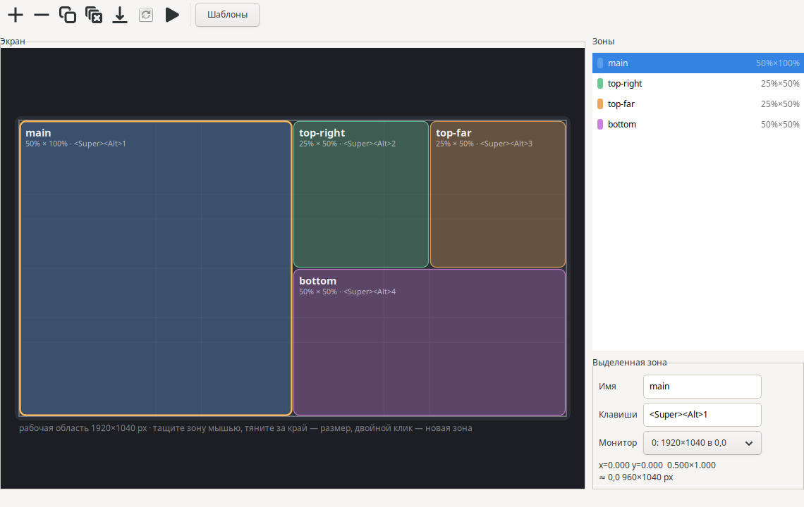
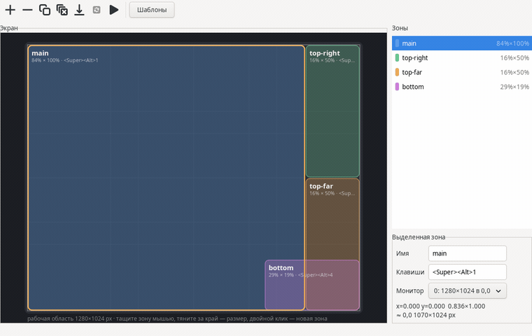

# Gridsnap — a window grid for Cinnamon: zone editor and hotkeys

Русский: [README.md](README.md)

Tested on Debian 13, Cinnamon 6.4.10 (Muffin, X11), a monitor with a 1920×1040 work area.






## Installation

Two independent paths: **for yourself** (from this directory, with no package manager) and
**as a package** (`.deb` for Debian/Ubuntu, an AUR recipe for Arch; a release `.tar.gz` for any
system). Both install the same code; the version comes from `VERSION` in
`zone-tiler.py`/`zone-daemon.py`.

### For yourself (from the repository)

Nothing is required beyond `python3`, PyGObject and `libX11` (already present in Debian):

```bash
./install-launcher.sh             # Gridsnap launcher in the menu + icons
./install-launcher.sh --desktop   # also a desktop shortcut
./install-daemon.sh               # autostart the auto-tiling daemon (--list / --remove)
python3 setup-hotkeys.py          # keybindings in Cinnamon
```

The launcher points to an absolute path to `zone-editor.py`; if the directory has moved, re-run
`./install-launcher.sh`. This is the path the author himself uses on his machine.

### As a package

Build the artifacts (`make` and `dpkg-deb` from the standard `dpkg` are required — no debhelper
and no new dependencies):

```bash
make tarball      # dist/gridsnap-<version>.tar.gz
make deb          # dist/gridsnap_<version>_all.deb
make aur          # AUR recipe in dist/PKGBUILD
```

The `deb` installs the code into `/usr/lib/gridsnap`, the commands `gridsnap-tiler`,
`gridsnap-daemon`, `gridsnap-editor`, `setup-hotkeys` into `/usr/bin`, and the launcher and
icons into `/usr/share`:

```bash
sudo apt install ./dist/gridsnap_<version>_all.deb
```

The `tar.gz` is installed into a prefix by the `install.sh` script (by default `$HOME/.local`):

```bash
tar -xzf gridsnap-<version>.tar.gz && cd gridsnap-<version>
./install.sh                    # ~/.local: code, commands, menu launcher, icons
./install.sh --prefix /usr/local
./install.sh --no-launcher      # code and commands only, no launcher or icons
./install.sh --uninstall        # remove what was installed from this prefix
```

The AUR recipe (`PKGBUILD`) is for Arch: put it in the package directory and build with
`makepkg -si`.

In both cases the config is looked up first in `~/.config/gridsnap/zones.conf` and, if it is not
there, next to the code. The code directory of a system package is read-only, so to edit the grid
under `deb`, copy the config to XDG:

```bash
mkdir -p ~/.config/gridsnap && cp /usr/lib/gridsnap/zones.conf ~/.config/gridsnap/
```

> "For yourself" and "as a package" do not interfere with each other, but they are not
> synchronized either: `install-launcher.sh` and `install-daemon.sh` work with the repository
> directory, while the package works with its own `/usr` paths.

Man pages (`man gridsnap`, `man gridsnap-tiler`) come with the package in `/usr/share/man/man1`
and `install.sh` puts them into `PREFIX/share/man/man1` even with `--no-launcher`.

## 1. What Cinnamon has out of the box

Cinnamon has **no** built-in grid editor (like FancyZones in Windows). There is only a fixed set
of tiles: halves and quarters of the screen.

```bash
cinnamon-settings tiling     # Settings → "Window tiling"
cinnamon-settings keyboard   # Settings → Keyboard → Shortcuts → "Tiling" section
```

| Action | How |
|---|---|
| half of the screen | `Super+←/→/↑/↓` or drag a window to an edge |
| quarter of the screen | `Super+←`, then `Super+↑/↓`; or drag into a corner |
| maximize / restore | `Alt+F10` / `Alt+F5` |

The tiling settings have only two toggles (enable tiling/snapping and "maximize instead of tiling
at the top edge") — you cannot define your own grid there.

## 2. A ready-made "select cells" grid: the gTile extension

`Settings → Extensions → "Download" tab → gTile`. Controls: `Super+G` — the grid, arrows — select,
`Shift`+arrows — extend over cells, `Space` — place the window, `1..4` — grid presets, `Alt`+arrows —
another monitor ([gTile page](https://cinnamon-spices.linuxmint.com/extensions/view/76)).

## 3. Your own zones: a visual editor and a tiler

Two tool files in this directory:

* `zone-editor.py` — a **visual grid editor** (a window with the screen, zones are dragged with the
  mouse);
* `zone-tiler.py` — the tiler: places the active window into a zone by name.

Dependencies: `python3`, `python3-gi` (GTK 3), `libX11`, `xprop` — already present in Debian.
`python3-cairo` is needed only to redraw the icon.

### 3.1. Starting the editor

Menu icon: **Gridsnap** (Favorites and Settings/Accessories). The launcher is installed with:

```bash
./install-launcher.sh             # launcher in the menu
./install-launcher.sh --desktop   # also a desktop shortcut
./install-launcher.sh --remove    # remove everything
```

Or directly from a terminal:

```bash
python3 zone-editor.py             # normal launch
python3 zone-editor.py --conf /path/zones.conf
python3 zone-editor.py --shot ui.png   # a UI snapshot without showing the window
```

If the directory moves elsewhere, re-run `./install-launcher.sh`; the launcher contains an
absolute path.

### 3.2. What the editor can do

| Action | How |
|---|---|
| select a zone | click a zone or a row in the list on the right |
| move | drag a zone with the mouse |
| resize | drag an edge or a corner (the cursor changes) |
| new zone | double-click on empty space, the "+" button |
| delete | `Delete` or the "−" button |
| duplicate / clear all | buttons on the toolbar |
| templates | the "Templates" button: 2 columns, 1+2, 2×2, 3 columns, main + stack, blank canvas |
| fine adjustment | arrows — move, `Ctrl`+arrows — resize, wheel — width |
| snapping | to screen edges, to neighbouring zone edges and to the 1/4, 1/3, 1/2, 2/3, 3/4 lines |
| zone name and key | the "Name" and "Keys" fields in the panel on the right |
| save | the "Save" button or `Ctrl+S` |
| apply keys | the "keybindings" button → updates the Cinnamon hotkeys |
| test | the "▶" button — places the active window into the selected zone |

Sizes are stored as fractions of the work area, so the grid does not break when the resolution
changes and takes the taskbar into account.

### 3.3. The `zones.conf` format

```ini
[grid]
cols = 1.0
rows = 1.0

[zones]
main      = 0, 0, 0.5, 1        # x, y, w, h as fractions (0..1)
top-right = 0.5, 0, 0.25, 0.5
bottom    = 0.5, 0.5, 0.5, 0.5

[keys]
main      = <Super><Alt>1
top-right = <Super><Alt>2
```

The old variant "a zone as a range of grid cells" is also supported:
`cols = 0.5, 0.75, 1.0`, `rows = 0.5, 1.0`, `main = 0:1, 0:2`. When saving, the editor converts
everything to `x,y,w,h` fractions.

The file is looked up first in `~/.config/gridsnap/zones.conf` (`$XDG_CONFIG_HOME` is honoured) and,
if it is not there, next to the code, `<repository directory>/zones.conf`. This way existing
installations do not break and the grid can live outside the repository:

```bash
mkdir -p ~/.config/gridsnap && cp zones.conf ~/.config/gridsnap/
```

The path can always be set explicitly with the `--conf` flag.

## 4. The tiler from the terminal

```bash
python3 zone-tiler.py list                  # zones and their pixel frames
python3 zone-tiler.py apply main --dry-run  # compute the frame
python3 zone-tiler.py apply main --verify   # place the active window and check the geometry
python3 zone-tiler.py apply bottom --monitor 1
python3 zone-tiler.py arrange               # lay windows out into zones (rules + free zones)
python3 zone-tiler.py arrange --by order    # lay out into zones in window-list order
python3 zone-tiler.py stack main            # stack windows in the main zone (cascade)
python3 zone-tiler.py undo                  # return windows from the last layout
python3 zone-tiler.py undo --all            # roll back the whole layout history
python3 zone-tiler.py --version             # tiler version
```

`arrange` takes client windows from `_NET_CLIENT_LIST` and puts them into zones: `--by auto`
(default) — first by `[rules]`, then the rest into free zones; `--by rules` — by rules only;
`--by order` — in order into zones in order. Windows without `WM_CLASS` and utility windows
(dialogs, splash) are left alone. Windows in the same zone are cascaded with a `--offset` px shift
(20 by default), so the title bars stay visible. `stack <zone>` is the same cascade, but all windows
into a single zone.

Every layout (`apply`, `arrange`, `stack`) is recorded in history; `undo` restores the previous
frames (`--all` — the whole history at once). History lives in
`~/.local/state/gridsnap/history.json` (`$XDG_STATE_HOME` is honoured), keeps the last 20 operations
and survives a restart. If a window is already closed or its XID has been reused by another
application, it is skipped gracefully. With the daemon running, `arrange`/`undo` are not coordinated
with it — stop the daemon first.

Exit codes: `0` — success, `1` — runtime error (no X, no active window), `2` — argument error
(unknown zone), `3` — config error.

It works through muffin's EWMH messages: it clears maximization/fullscreen and compensates for the
window frame (`_NET_FRAME_EXTENTS`), so the zone matches the window frame pixel for pixel.

## 5. The daemon: auto-tiling new windows

To have a window go into a zone by itself (by rule), start the daemon:

```bash
python3 zone-daemon.py             # listen for events until Ctrl-C
python3 zone-daemon.py --verbose   # show what it is doing
python3 zone-daemon.py --once      # process one window-list change and exit
python3 zone-daemon.py --version
```

The daemon watches the EWMH `_NET_CLIENT_LIST` and, when a window appears, places it according to
the rules from `zones.conf`. The `[rules]` section is "selector → zone":

```ini
[rules]
Chrome = main                   # case-insensitive glob on WM_CLASS
TelegramDesktop = top-right
re:^(Navigator|firefox) = main  # regex on the "class|title" string
```

The first match wins; a rule pointing to an unknown zone is a config error. Windows without a rule,
without `WM_CLASS`, and utility windows (dialogs, splash, menus) are left alone by the daemon. The
daemon determines a window's monitor itself — from the window centre — and tiles into that monitor's
work area (it has no `--monitor` flag); reflow also stays within a single monitor.

To have a neighbouring occupied zone expand into the freed area when a window closes (if their union
is a rectangle), enable reflow:

```ini
[daemon]
reflow = neighbors   # off (default) | neighbors
```

When a window again goes into the freed zone by rule, the expanded neighbour returns to its original
frame from the config.

Autostart in a Cinnamon session:

```bash
./install-daemon.sh            # enable autostart
./install-daemon.sh --list     # show what is enabled
./install-daemon.sh --remove   # disable
```

The script writes `~/.config/autostart/gridsnap-daemon.desktop` with
`Exec=python3 <directory>/zone-daemon.py`. The daemon reads the same `zones.conf` (first XDG, then
next to the code); the path can be set with `--conf`.

## 6. Hotkeys

Already installed in your session: `Super+Alt+1` main, `+2` top-right, `+3` top-far, `+4` bottom
(visible in Settings → Keyboard → Shortcuts as "zone-tiler: …"). To edit them: change `[keys]` in
`zones.conf` and press "keybindings" in the editor, or:

```bash
python3 setup-hotkeys.py --list     # what will be installed
python3 setup-hotkeys.py            # install / update
python3 setup-hotkeys.py --remove   # remove all zone-tiler shortcuts
```

## 7. If a window does not fit

* the application sets its own size (a terminal with a character step) — a difference of a couple
  of pixels is possible;
* a zone with zero area is not saved: the minimum size is 5% of the screen;
* Wayland is not supported, but Cinnamon runs on X11;
* after editing `zones.conf` by hand, re-run `setup-hotkeys.py`, otherwise the new zone names
  will not be bound to keys.

## 8. The checks that were run

* unit tests without X (parser, rules, reflow, daemon, config layer, arrange/undo, editor geometry
  `zone_geom`): `python3 -m unittest discover -s tests -v`;
* smoke test on its own Xvfb: `sh tests/smoke.sh` (the window goes into the zone pixel for pixel);
* arrange+undo smoke test: `sh tests/smoke-arrange.sh` (three windows are laid out and restored);
* CI (`.github/workflows/ci.yml`): compilation, unit tests and the smoke test (Xvfb + muffin);
* config: read from `~/.config/gridsnap/zones.conf` when present, otherwise next to the code;
* tiling from the terminal: the window frame matched the zone (including from a maximized state);
* free rectangular zones (`x,y,w,h`) — also an exact match;
* mouse in the editor: move, edge resize, minimum size, snapping to the screen edge and to a
  neighbouring zone, double click, `Delete`, templates, save and re-read;
* launcher launch, icon lookup by the GTK theme, `desktop-file-validate`;
* packages: `make tarball` (unpack and `./install.sh --prefix ...`) and `make deb` (`dpkg-deb -I`,
  `dpkg-deb -c`, unpack and `zone-tiler.py --version` from the package); the same is run as a
  separate CI stage (`.github/workflows/ci.yml`).
