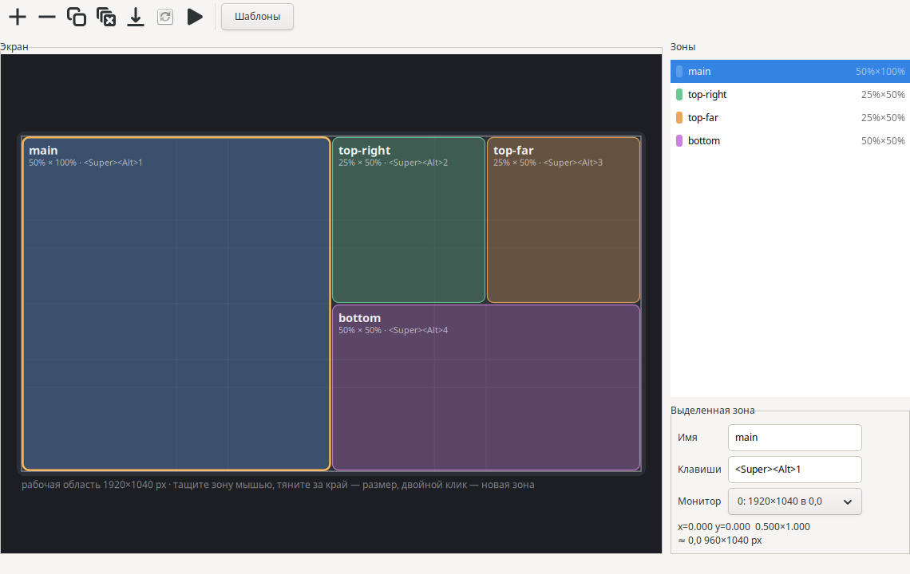
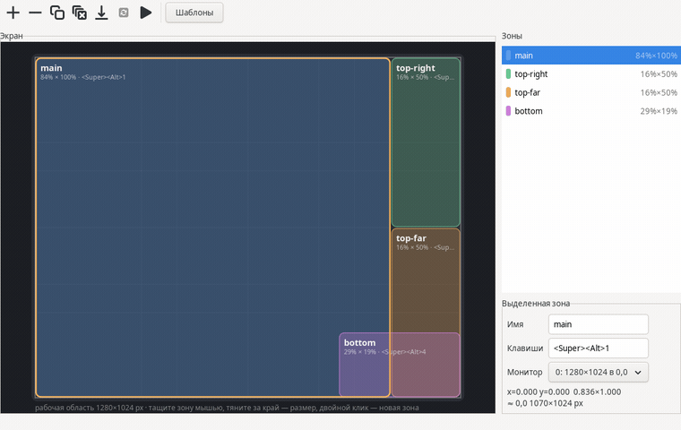

# Gridsnap — сетка окон в Cinnamon: редактор зон и горячие клавиши

English: [README.en.md](README.en.md)

Проверено на Debian 13, Cinnamon 6.4.10 (Muffin, X11), монитор 1920×1040 рабочей области.






## Установка

Два независимых пути: **для себя** (из этого каталога, без пакетного менеджера) и **пакетом**
(`.deb` для Debian/Ubuntu, AUR-рецепт для Arch; релизный `.tar.gz` — для любой системы).
Оба ставят один и тот же код; версия берётся из `VERSION` в `zone-tiler.py`/`zone-daemon.py`.

### Для себя (из репозитория)

Ничего не требуется, кроме `python3`, PyGObject и `libX11` (в Debian уже стоят):

```bash
./install-launcher.sh             # ярлык Gridsnap в меню + иконки
./install-launcher.sh --desktop   # ещё и ярлык на рабочем столе
./install-daemon.sh               # автозапуск демона автоукладки (--list / --remove)
python3 setup-hotkeys.py          # сочетания клавиш в Cinnamon
```

Ярлык ссылается на абсолютный путь к `zone-editor.py`; если каталог переехал — перезапустите
`./install-launcher.sh`. Это тот путь, которым пользуется сам автор на своей машине.

### Пакетом

**Штатным пакетом Debian.** В каталоге есть `debian/` (debhelper, compat 13, плюс `dh-exec`
для переименования иконок); зависимости сборки — только из `main` тризки:

```bash
sudo apt install debhelper dh-exec    # разовые зависимости сборки
dpkg-buildpackage -b -us -uc          # соберёт ../gridsnap_<версия>-1_all.deb
sudo apt install ../gridsnap_<версия>-1_all.deb
```

**Через `Makefile`** (без debhelper): нужны `make` и `dpkg-deb` из штатного `dpkg`.

```bash
make tarball      # dist/gridsnap-<версия>.tar.gz
make deb          # dist/gridsnap_<версия>_all.deb
make aur          # рецепт AUR в dist/PKGBUILD
```

Оба пути ставят одно и то же: код в `/usr/lib/gridsnap`, команды `gridsnap-tiler`, `gridsnap-daemon`,
`gridsnap-editor`, `gridsnap-picker`, `gridsnap-ctl`, `setup-hotkeys` — в `/usr/bin`, ярлык и иконки —
в `/usr/share`. Установка `make deb`:

```bash
sudo apt install ./dist/gridsnap_<версия>_all.deb
```

`tar.gz` ставится в префикс скриптом `install.sh` (по умолчанию `$HOME/.local`):

```bash
tar -xzf gridsnap-<версия>.tar.gz && cd gridsnap-<версия>
./install.sh                    # ~/.local: код, команды, ярлык в меню, иконки
./install.sh --prefix /usr/local
./install.sh --no-launcher      # только код и команды, без ярлыка и иконок
./install.sh --uninstall        # убрать поставленное из этого префикса
```

AUR-рецепт (`PKGBUILD`) — для Arch: положите его в каталог пакета и соберите `makepkg -si`.

Конфиг и там, и там ищется сначала в `~/.config/gridsnap/zones.conf`, а если его нет — рядом с кодом.
Каталог кода системного пакета доступен только на чтение, поэтому для правки сетки под `deb`
скопируйте конфиг в XDG:

```bash
mkdir -p ~/.config/gridsnap && cp /usr/lib/gridsnap/zones.conf ~/.config/gridsnap/
```

> «Для себя» и «пакетом» не мешают друг другу, но и не синхронизируются: `install-launcher.sh`
> и `install-daemon.sh` работают с каталогом репозитория, а пакет — со своими путями `/usr`.

### Справка

man-страницы входят в пакет (`/usr/share/man/man1`), а `install.sh` кладёт их в
`ПРЕФИКС/share/man/man1` — в том числе при `--no-launcher`: это документация, а не часть ярлыка.
`man gridsnap` — команды пакета, `zones.conf`, файлы и коды возврата; `man gridsnap-tiler` —
та же страница (как и `man gridsnap-daemon`, `man gridsnap-editor`, `man gridsnap-picker`,
`man gridsnap-ctl`, `man setup-hotkeys`).

## 1. Что есть в Cinnamon из коробки

Встроенного редактора сетки (как FancyZones в Windows) в Cinnamon **нет**. Есть только
фиксированный набор плиток: половины и четверти экрана.

```bash
cinnamon-settings tiling     # Параметры → «Мозаика окон»
cinnamon-settings keyboard   # Параметры → Клавиатура → Горячие клавиши → раздел «Мозаика»
```

| Действие | Как |
|---|---|
| половина экрана | `Super+←/→/↑/↓` или перетащить окно к краю |
| четверть экрана | `Super+←`, затем `Super+↑/↓`; либо перетащить в угол |
| развернуть / снять | `Alt+F10` / `Alt+F5` |

В настройках мозаики всего два переключателя (включить тайлинг/прилипание и «разворачивать,
а не тайлить, у верхнего края») — свою сетку там не задать.

## 2. Готовая сетка «выделил ячейки»: расширение gTile

`Параметры → Расширения → вкладка «Загрузка» → gTile`. Управление: `Super+G` — сетка,
стрелки — выделение, `Shift`+стрелки — растянуть на ячейки, `Пробел` — вложить окно,
`1..4` — наборы сеток, `Alt`+стрелки — другой монитор
([страница gTile](https://cinnamon-spices.linuxmint.com/extensions/view/76)).

## 3. Свои зоны: визуальный редактор и раскладчик

Три файла-инструмента в этом каталоге:

* `zone-editor.py` — **визуальный редактор** сетки (окно с экраном, зоны таскаются мышью);
* `zone-tiler.py` — раскладчик: вкладывает активное окно в зону по имени;
* `zone-picker.py` — **визуальный выбор зоны** по `Super+Z` (оверлей, стрелки, `Enter`).

Зависимости: `python3`, `python3-gi` (GTK 3), `libX11`, `xprop` — в Debian уже стоят.
`python3-cairo` нужен для перерисовки иконки и для снимка оверлея выбора зоны.

### 3.1. Запуск редактора

Иконка в меню: **Gridsnap** (Избранное и Параметры/Служебные). Ярлык ставится командой:

```bash
./install-launcher.sh             # ярлык в меню
./install-launcher.sh --desktop   # ещё и ярлык на рабочем столе
./install-launcher.sh --remove    # убрать всё
```

Или прямо из терминала:

```bash
python3 zone-editor.py             # обычный запуск
python3 zone-editor.py --conf /путь/zones.conf
python3 zone-editor.py --shot ui.png   # снимок интерфейса без показа окна
```

Если каталог переедет в другое место — перезапустите `./install-launcher.sh`, ярлык
содержит абсолютный путь.

### 3.2. Что умеет редактор

| Действие | Как |
|---|---|
| выбрать зону | клик по зоне или по строке в списке справа |
| переместить | тащить зону мышью |
| изменить размер | тянуть за край или угол (курсор меняется) |
| новая зона | двойной клик по пустому месту, кнопка «+» |
| удалить | `Delete` или кнопка «−» |
| копия / очистить всё | кнопки на панели |
| шаблоны | кнопка «Шаблоны»: 2 колонки, 1+2, 2×2, 3 колонки, главное + стек, чистый лист |
| свои профили | кнопка «Профили»: загрузить профиль в холст, «Сохранить текущую раскладку как профиль…», удалить |
| точная подгонка | стрелки — сдвиг, `Ctrl`+стрелки — размер, колесо — ширина |
| прилипание | к краям экрана, к краям соседних зон и к линиям 1/4, 1/3, 1/2, 2/3, 3/4 |
| имя и клавиша зоны | поля «Имя» и «Клавиши» в панели справа |
| сохранить | кнопка «Сохранить» или `Ctrl+S` |
| применить клавиши | кнопка «сочетания клавиш» → обновляет горячие клавиши Cinnamon |
| проверить | кнопка «▶» — вкладывает активное окно в выделенную зону |

Размеры хранятся в долях рабочей области, поэтому сетка не ломается при смене
разрешения и учитывает панель задач.

### 3.3. Формат `zones.conf`

```ini
[grid]
cols = 1.0
rows = 1.0

[zones]
main      = 0, 0, 0.5, 1        # x, y, w, h в долях (0..1)
top-right = 0.5, 0, 0.25, 0.5
bottom    = 0.5, 0.5, 0.5, 0.5

[keys]
main      = <Super><Alt>1
top-right = <Super><Alt>2
```

Если экранов несколько, у монитора может быть свой набор зон — секция `[zones:<имя выхода>]`
(имя выхода берётся из `xrandr --listmonitors`: `eDP-1`, `HDMI-1`). Монитор без своей секции
берёт общий `[zones]`, поэтому старый файл продолжает работать на любом числе экранов:

```ini
[zones]              # набор по умолчанию
main = 0, 0, 0.5, 1
side = 0.5, 0, 0.5, 1

[zones:HDMI-1]       # вертикальный экран: своя сетка
top    = 0, 0, 1, 0.5
bottom = 0, 0.5, 1, 0.5
```

`--monitor` принимает и имя выхода, и номер (`--monitor HDMI-1`, `--monitor 1`); секция
отключённого монитора остаётся в файле и ждёт, пока его подключат.

Рабочие столы получают свои сетки через профили — секция `[workspaces]` сопоставляет номер стола
(как в интерфейсе Cinnamon, с 1) и профиль из `templates/`:

```ini
[workspaces]
1 = work
2 = cinema
```

`zone-tiler.py apply main --workspace 1` кладёт окно по сетке второго стола, `--workspace conf` — всегда
по общему `zones.conf` (так делает редактор), а без флага берётся активный стол.

Старый вариант «зона как диапазон ячеек сетки» тоже поддерживается:
`cols = 0.5, 0.75, 1.0`, `rows = 0.5, 1.0`, `main = 0:1, 0:2`. Редактор при сохранении
переводит всё в доли `x,y,w,h`.

Автоукладку задаёт секция `[rules]` (селектор → зона), а окна, которые GridSnap не должен двигать —
секция `[ignore]` с теми же селекторами; обе описаны в §5.

Файл ищется сначала в `~/.config/gridsnap/zones.conf` (учитывается `$XDG_CONFIG_HOME`), а если
его там нет — рядом с кодом, `<каталог репозитория>/zones.conf`. Так текущие установки
не ломаются, а сетку можно вынести из репозитория:

```bash
mkdir -p ~/.config/gridsnap && cp zones.conf ~/.config/gridsnap/
```

Путь всегда можно задать явно флагом `--conf`. Профили раскладок лежат рядом с `zones.conf` в
подкаталоге `templates/` (по умолчанию `~/.config/gridsnap/templates/`).

## 4. Раскладчик из терминала

```bash
python3 zone-tiler.py list                  # зоны и их пиксельные рамки
python3 zone-tiler.py apply main --dry-run  # посчитать рамку
python3 zone-tiler.py apply main --verify   # вложить активное окно и сверить геометрию
python3 zone-tiler.py apply bottom --monitor 1
python3 zone-tiler.py arrange               # разложить окна по зонам (правила + свободные зоны)
python3 zone-tiler.py arrange --by order    # разложить по зонам в порядке списка окон
python3 zone-tiler.py stack main            # собрать окна в зону main стопкой (каскадом)
python3 zone-tiler.py undo                  # вернуть окна из последней раскладки
python3 zone-tiler.py undo --all            # откатить всю историю раскладок
python3 zone-tiler.py profile list          # свои профили раскладок
python3 zone-tiler.py profile save work     # сохранить текущий zones.conf как профиль «work»
python3 zone-tiler.py profile use work      # активировать профиль и обновить сочетания
python3 zone-tiler.py profile use work --no-hotkeys   # только активировать, без сочетаний
python3 zone-tiler.py profile show work     # что лежит в профиле
python3 zone-tiler.py profile rm work       # удалить профиль
python3 zone-tiler.py --version             # версия раскладчика
```

`arrange` берёт клиентские окна `_NET_CLIENT_LIST` и кладёт их по зонам: `--by auto` (по умолчанию) —
сначала по правилам `[rules]`, затем остальные по свободным зонам; `--by rules` — только по правилам;
`--by order` — по порядку в зоны по порядку. Окна без `WM_CLASS`, служебные (диалоги, splash) и попавшие под
`[ignore]` не трогаются. Окна в одной зоне ложатся каскадом со сдвигом `--offset` px (по умолчанию 20), так
что видны заголовки. `stack <зона>` — тот же каскад, но все окна в одну зону.

Каждая раскладка (`apply`, `arrange`, `stack`) записывается в историю; `undo` возвращает прежние
рамки (`--all` — сразу всю историю). История лежит в `~/.local/state/gridsnap/history.json`
(учитывается `$XDG_STATE_HOME`), хранит последние 20 операций и переживает перезапуск. Если окно
уже закрыто или его XID переиспользован другим приложением, оно аккуратно пропускается. С запущенным
демоном `arrange`/`undo` не согласованы — сначала остановите демон.

Коды возврата: `0` — успех, `1` — ошибка выполнения (нет X, нет активного окна),
`2` — ошибка аргументов (неизвестная зона, плохое имя профиля), `3` — ошибка конфига (нет/битый
профиль).

**Профиль раскладки** — это полный набор: секции `[zones]` (+ привязки из `[keys]`), `[rules]` и `[ignore]`.
Секции `[grid]` и `[daemon]` в профиль не входят. Профили лежат в `~/.config/gridsnap/templates/<имя>.conf`
(учитывается `$XDG_CONFIG_HOME`; с `--conf PATH` — каталог `templates` рядом с этим файлом), формат —
как у `zones.conf`, читается и переносится глазами. `profile save` берёт текущий `zones.conf`,
`profile use` перекладывает зоны/правила/исключения/клавиши профиля в активный `zones.conf`, не трогая
`[grid]`, `[daemon]` и прочие секции. После `use` обновляются сочетания клавиш (`setup-hotkeys.py --conf …`);
`--no-hotkeys` отключает это. Экспорт/импорт JSON (`profile export`/`import`) переносит тот же набор.
Подробности — в `docs/specs/zone-tiler.md`.

Работает через EWMH-сообщения muffin: снимает максимизацию/фуллскрин, компенсирует рамку
окна (`_NET_FRAME_EXTENTS`), поэтому зона совпадает с рамкой окна пиксель в пиксель.

## 5. Демон: автоукладка новых окон

Чтобы окно вставало в зону само (по правилу), запустите демон:

```bash
python3 zone-daemon.py             # слушать события до Ctrl-C (и поднять IPC-сокет)
python3 zone-daemon.py --verbose   # показывать, что делает
python3 zone-daemon.py --once      # обработать одно изменение списка окон и выйти
python3 zone-daemon.py --no-socket # без IPC, только автоукладка
python3 zone-daemon.py --socket /путь/daemon.sock
python3 zone-daemon.py --version
```

Демон следит за EWMH-списком `_NET_CLIENT_LIST` и при появлении окна вкладывает его по правилам из
`zones.conf`. Секция `[rules]` — «селектор → зона»:

Демон знает и рабочие столы: сетку он берёт по столу окна (см. §3.3, `[workspaces]`), занятость считает
по паре «стол + монитор», а reflow делает только на видимом столе — окна невидимых столов не
переставляются.

```ini
[rules]
Chrome = main                   # glob по WM_CLASS без учёта регистра
TelegramDesktop = top-right
re:^(Navigator|firefox) = main  # регулярка по строке "класс|заголовок"
```

Побеждает первое совпадение; правило на неизвестную зону — ошибка конфига.

Что демон **не** трогает, задаётся двумя слоями. Первый — служебные типы `_NET_WM_WINDOW_TYPE`
(`DIALOG`, `SPLASH`, `TOOLTIP`, `DROPDOWN_MENU`, `UTILITY`) — неотключаемая защита от всплывающих окон.
Второй — секция `[ignore]`, те же селекторы, что у `[rules]`; правая часть строки — заметка для человека и
журнала демона:

```ini
[ignore]
TelegramDesktop = диалоги Telegram
re:^(Navigator|firefox).*(Library|Библиотека) = окно библиотеки
```

Исключённое окно не двигают ни демон (`on_map`), ни `arrange`/`stack`, ни горячие клавиши `apply`/`move`,
ни `undo`, ни пикер (`Enter` откажет с сообщением), ни watcher перетаскивания `zone-hotcorners` (HUD для
такого окна не появится) — везде работает одна проверка `window_excluded`.
Хотите переставить такое окно — уберите или поправьте правило.

Окно, которое пользователь сам вынес из зоны, демон больше туда не возвращает: он запоминает рамку
укладки и на каждой реконсиляции видит, что окно ушло. Это переживает перезапуск демона (файл состояния
`~/.local/state/gridsnap/placed.json`) и сбрасывается, когда окно закрывают и открывают заново. Монитор окна
демон определяет сам — по центру окна, — и укладывает в рабочей области этого монитора (флага `--monitor`
у него нет); reflow остаётся в пределах одного монитора.

Чтобы при закрытии окна соседняя занятая зона расширялась на освободившуюся площадь (если их объединение —
прямоугольник), включите reflow:

```ini
[daemon]
reflow = neighbors   # off (по умолчанию) | neighbors
```

Когда в освободившуюся зону снова встаёт окно по правилу, расширенный сосед возвращается к своей
исходной рамке из конфига.

Автозапуск в сессии Cinnamon:

```bash
./install-daemon.sh            # включить автозапуск
./install-daemon.sh --list     # показать, что стоит
./install-daemon.sh --remove   # выключить
```

Скрипт кладёт `~/.config/autostart/gridsnap-daemon.desktop` с `Exec=python3 <каталог>/zone-daemon.py`.
Демон читает тот же `zones.conf` (сначала XDG, затем рядом с кодом); путь можно задать `--conf`.

### 5.1. IPC: управление демоном через `gridsnap-ctl`

Пока демон работает, он слушает локальный UNIX-сокет (`$XDG_RUNTIME_DIR/gridsnap/daemon.sock`, права
`0600`; флаг `--socket PATH` у демона и клиента, `--no-socket` — выключить IPC). Отдельный клиент
`gridsnap-ctl` (Python, без зависимостей) говорит с ним по JSON:

```bash
python3 gridsnap-ctl status                      # зоны, окно→зона, монитор, reflow (JSON)
python3 gridsnap-ctl apply main                  # вложить активное окно в зону main
python3 gridsnap-ctl apply main --window 0x1a00007
python3 gridsnap-ctl apply top-right --monitor 1
python3 gridsnap-ctl reload                      # демон перечитает zones.conf
python3 gridsnap-ctl quit                        # остановить демон
```

Протокол — одна JSON-строка на команду, ответ — тоже JSON (`{"ok": true, ...}` или
`{"ok": false, "error": "..."}`); сокет только локальный, TCP нет. Ошибка сокета (битая строка,
обрыв) демон не роняет — логирует и продолжает следить за окнами. `apply` пишется в трекер демона,
поэтому закрытие окна затем штатно запускает reflow. Для пакетных установок клиент доступен как
`gridsnap-ctl` (в `.deb` и через `install.sh` — команда в `$PREFIX/bin`).

## 6. Горячие края: перетащил к сетке — окно в зоне

Тащишь окно за полосу заголовка — появляется сетка зон с подсветкой той, куда попал курсор; отпустил — окно
встаёт в неё. Это отдельный процесс, он не нужен для обычной работы и не мешает демону:

```bash
python3 zone-hotcorners.py            # слушать перетаскивания (Ctrl-C — выход)
python3 zone-hotcorners.py --no-hud   # без подсветки: только вкладывать по отпусканию
python3 zone-hotcorners.py --dry-run --verbose   # показать, что делал бы
```

Как это устроено: X11 не сообщает «окно тащат», поэтому watcher слушает XI2 raw events (они приходят даже
когда мышь захвачена оконным менеджером) и считает перетаскиванием нажатие кнопки в полосе заголовка. Пока
показана сетка, родной «бросок к краю» Cinnamon (`edge-tiling`) гасится, чтобы окно не прыгнуло дважды, и
возвращается сразу после — настройка не остаётся выключенной. Подробности — `docs/specs/zone-hotcorners.md`,
`man gridsnap-hotcorners`.

## 7. Клавиши направлений: окно в соседнюю зону

`zone-tiler.py move left|right|up|down` перекладывает активное окно в соседнюю зону — без оверлея, по тем
же правилам, что стрелки в пикере (на краю сетки ничего не делает и говорит об этом). Сочетания
настраиваются секцией `[move]` в `zones.conf`, по умолчанию `Super+Left/Right/Up/Down`:

```ini
[move]
left  = <Super>Left
right = <Super>Right
up    = <Super>Up
down  = <Super>Down
```

Эти же сочетания в Cinnamon заняты родным тайлингом (`push-tile-*`). Наш `setup-hotkeys.py` регистрирует
свои и предупреждает в stderr, если сочетание совпало; настройки Cinnamon при этом не меняются. Если
срабатывает родной тайлинг вместо нашего — освободите `push-tile-*` в «Клавиатура → Горячие клавиши →
Окна» или задайте в `[move]` другое сочетание.

## 8. Визуальный выбор зоны: `Super+Z`

`zone-picker.py` показывает оверлей на всю рабочую область с зонами из `zones.conf`: зона под курсором
и выделение подсвечиваются, **стрелки** двигают выделение, **`Enter`** вкладывает активное окно в
выбранную зону, **`Esc`** отменяет (как gTile, но по вашей сетке). Монитор берётся по активному окну,
его можно задать явно.

```bash
python3 zone-picker.py                    # оверлей (запускается горячей клавишей)
python3 zone-picker.py --dry-run          # выбрать зону, но окно не двигать
python3 zone-picker.py --shot picker.png  # снимок оверлея и выход (без интерактива)
python3 zone-picker.py --monitor 1        # оверлей на втором мониторе
python3 zone-picker.py --select bottom    # начальное выделение по имени зоны
```

Применение окна идёт через тот же раскладчик (`zone-tiler.apply_zone`/`Grid.rect`), поэтому рамка
совпадает с зоной пиксель в пиксель и по `Enter` работает `undo`.

### Как завести `Super+Z` в Cinnamon

Сочетание не создаётся автоматически (`setup-hotkeys.py` ставит только клавиши зон из `[keys]`) —
заведите его один раз вручную: **Параметры → Клавиатура → Горячие клавиши → «Добавить
пользовательское сочетание»** и заполните:

| Поле | Значение |
|---|---|
| Имя | `GridSnap: выбор зоны` |
| Команда | `python3 /путь/к/каталогу/zone-picker.py` (для пакета — просто `gridsnap-picker`) |
| Сочетание | `Super+Z` |

То же открывается командой `cinnamon-settings keyboard`. Сочетание `Super+Z` в Cinnamon по умолчанию
свободно. После правки `zones.conf` путь к `zone-picker.py` менять не нужно — оверлей каждый раз читает
актуальный конфиг сам.

## 9. Горячие клавиши

Уже установлены в вашей сессии: `Super+Alt+1` main, `+2` top-right, `+3` top-far,
`+4` bottom (видны в Параметры → Клавиатура → Горячие клавиши как «zone-tiler: …»).
Правка: поменяйте `[keys]` в `zones.conf` и нажмите в редакторе «сочетания клавиш», либо:

```bash
python3 setup-hotkeys.py --list     # что будет установлено
python3 setup-hotkeys.py            # установить / обновить
python3 setup-hotkeys.py --remove   # удалить все сочетания zone-tiler
```

### 7.1. Профили раскладок одной клавишей

Свой профиль (например, «работа», «кино», «стрим») можно сохранить командой
`zone-tiler.py profile save <имя>` или из меню «Профили» в редакторе. Чтобы переключать раскладку
**одной клавишей**, заведите обычное пользовательское сочетание Cinnamon:

1. Параметры → Клавиатура → Горячие клавиши → «Добавить пользовательское сочетание».
2. Имя — например, `Gridsnap: профиль work`.
3. Команда — `python3 /путь/к/zone-tiler.py profile use work` (при необходимости добавьте
   `--conf /путь/к/zones.conf`; чтобы не дёргать сочетания при каждом переключении — `--no-hotkeys`).
4. Назначьте сочетание, например `Super+Alt+W`.

Команда сама перепишет `[zones]`/`[rules]`/`[ignore]`/`[keys]` в вашем `zones.conf` из выбранного профиля. Если
нужно, чтобы после переключения сразу работали новые клавиши зон, оставьте вызов `setup-hotkeys.py`
(он идёт по умолчанию) или нажмите «сочетания клавиш» в редакторе.
## 10. Апплет Cinnamon: доступ к GridSnap из панели

В каталоге `contrib/applet/` лежит панельный апплет `gridsnap@metapeka`: иконка (и по желанию
надпись) в панели, меню по левому и правому клику — открыть редактор, применить сочетания, список
зон (клик кладёт активное окно в зону), сводка по рабочим областям, `arrange` и `undo`. Апплет —
тонкая обёртка над теми же скриптами, своей логики раскладки в нём нет; каталог GridSnap задаётся
в его настройках (по умолчанию `~/thinkrail/gridsnape`).

Установка:

```bash
mkdir -p ~/.local/share/cinnamon/applets
cp -r contrib/applet/gridsnap@metapeka ~/.local/share/cinnamon/applets/
cinnamon-settings applets        # включить GridSnap в списке апплетов
```

Что в меню, какие настройки и ограничения — в `contrib/applet/README.md`.

## 11. Если окно не встаёт на место

* приложение само задаёт размер (терминал с шагом символа) — возможна разница в пару пикселей;
* зона с нулевой площадью не сохранится: минимальный размер 5 % экрана;
* Wayland не поддерживается, но Cinnamon работает на X11;
* после правки `zones.conf` руками перезапустите `setup-hotkeys.py`, иначе новые имена зон
  не будут связаны с клавишами.

## 12. Проверки, которые прогонялись

* юнит-тесты без X (парсер, правила, reflow, демон, IPC `zone_ipc`, конфиг-слой, arrange/undo,
  геометрия редактора `zone_geom`, навигация выбора зоны `zone_picker_nav`):
  `python3 -m unittest discover -s tests -v`;
* дымовой тест на своём Xvfb: `sh tests/smoke.sh` (окно встаёт в зону пиксель в пиксель);
* дымовой тест arrange+undo: `sh tests/smoke-arrange.sh` (три окна раскладываются и возвращаются);
* дымовой тест выбора зоны: `sh tests/smoke-picker.sh` (`Right` + `Enter` кладут окно в `top-right`
  пиксель в пиксель, `Esc` отменяет);
* дымовой тест исключений окон: `sh tests/smoke-ignore.sh` (исключённое окно не двигают `apply`,
  `arrange`, демон и пикер, а окно, вынесенное из зоны, не возвращается даже после перезапуска демона);
* снимок оверлея без интерактива: `xvfb-run -a python3 zone-picker.py --shot /tmp/picker.png`;
* CI (`.github/workflows/ci.yml`): компиляция, юнит-тесты, сборка пакетов и дымовые сценарии на Xvfb + muffin. Все job'ы — на `ubuntu-latest` у GitHub, не на своей машине; у каждого есть `timeout-minutes` (10/15/20/20), а дымовые шаги идут через `tests/run-smoke.sh` с одной повторной попыткой: в CI окно иногда не успевает получить геометрию от muffin, и проверка падает на тайминге, а не на коде;
* слежение за CI без риска заснуть: `tools/ci-watch.sh --pr 14` (или `tools/ci-watch.sh <run-id>`).
  Печатает смену статуса и всегда завершается сам: `0` — всё зелёное, `1` — упало,
  `2` — зависло (статус не менялся дольше `--stall`, по умолчанию 3 минуты) или вышло
  `--deadline` (15 минут). Отличается от `gh run watch` именно тем, что говорит «зависло»
  вместо бесконечного ожидания;
* конфиг: чтение из `~/.config/gridsnap/zones.conf` при его наличии, иначе рядом с кодом;
* раскладка из терминала: рамка окна совпала с зоной (в т.ч. из развёрнутого состояния);
* свободные прямоугольные зоны (`x,y,w,h`) — тоже точное совпадение;
* мышь в редакторе: перемещение, resize за край, минимальный размер, прилипание к краю
  экрана и к соседней зоне, двойной клик, `Delete`, шаблоны, сохранение и повторное чтение;
* запуск ярлыка, поиск иконки темой GTK, `desktop-file-validate`;
* пакеты: `make tarball` (распаковка и `./install.sh --prefix ...`) и `make deb`
  (`dpkg-deb -I`, `dpkg-deb -c`, распаковка и `zone-tiler.py --version` из пакета); это же
  прогоняется отдельной стадией CI (`.github/workflows/ci.yml`);
* апплет Cinnamon: `python3 -m json.tool` для `metadata.json` и `settings-schema.json`,
  `node --check applet.js`, загрузка в живом Cinnamon (headless `Xvfb` + приватный dbus) —
  `Loaded applet gridsnap@metapeka`, на панели ровно он (`contrib/applet/check-cinnamon.sh`).
