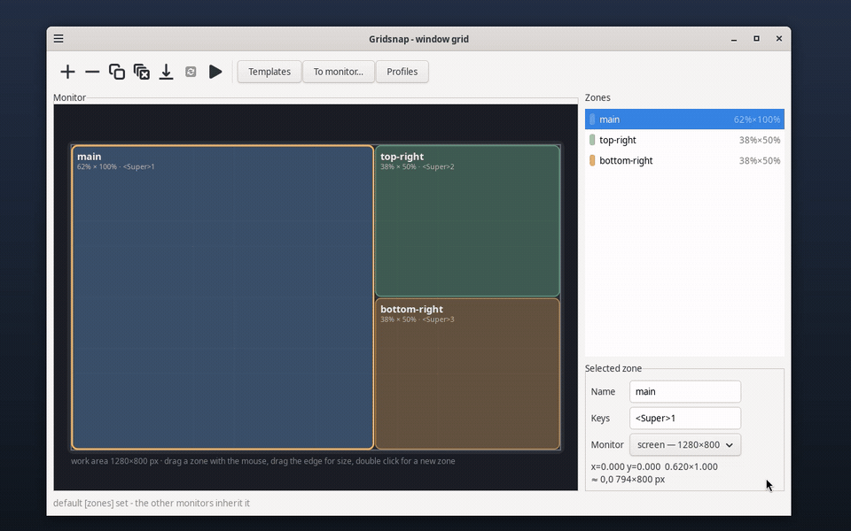

# Gridsnap — a window grid for Cinnamon: zone editor and hotkeys

[**English**](README.md) · [简体中文](README.zh.md) · [Русский](README.ru.md)

Tested on Debian 13, Cinnamon 6.4.10 (Muffin, X11), a 1920×1040 work area.




<!-- section: languages -->
## Interface languages

The interface speaks **English**, **Simplified Chinese** and **Russian**. The strings in the source
are Russian — that is the source language — and English is the default for every other locale:

- `ru*` (`ru`, `ru_RU.UTF-8`) — Russian, the source strings themselves; no catalog is needed;
- `zh*` (`zh_CN`, `zh_CN.UTF-8`, `zh-Hans`) — Simplified Chinese;
- everything else (`en`, `de`, `C`, nothing set) — English.

The language comes from `GRIDSNAP_LANG` first and then from `LC_ALL`, `LC_MESSAGES`, `LANG`, so it
can be switched for a single command:

```bash
GRIDSNAP_LANG=en gridsnap-tiler list
```

Running from a checkout needs no build: when the compiled catalogs are missing, the tools read
`po/<language>.po` straight from the repository (`make mo` builds them, and the installers put the
compiled `.mo` under `share/locale`). The Cinnamon applet follows the session locale, as xlets do,
and does not look at `GRIDSNAP_LANG`. The English and Chinese catalogs are machine translations, not
proofread by native speakers. The man pages follow the same rule: `man gridsnap` picks the page by
locale — English by default, Russian under `ru*`, Chinese under `zh*` — and the English and Chinese
pages are machine translations too.

<!-- section: install -->
## Installation

Two independent paths: **for yourself** (from this directory, without a package manager) and **as a
package** (a `.deb` for Debian/Ubuntu, an AUR recipe for Arch; the release `.tar.gz` for any system).
Both install the same code; the version comes from `VERSION` in `zone-tiler.py`/`zone-daemon.py`.

<!-- section: install-self -->
### From the repository (for yourself)

Nothing is required beyond `python3`, PyGObject and `libX11` (already present in Debian):

```bash
./install-launcher.sh             # Gridsnap launcher in the menu + icons
./install-launcher.sh --desktop   # also a shortcut on the desktop
./install-daemon.sh               # autostart the auto-tiling daemon (--list / --remove)
python3 setup-hotkeys.py          # keybindings in Cinnamon
```

The launcher points at an absolute path to `zone-editor.py`; if the directory has moved, re-run
`./install-launcher.sh`. This is the path the author himself uses on his machine.

<!-- section: install-package -->
### As a package

**The stock Debian package.** The directory ships `debian/` (debhelper, compat 13, plus `dh-exec` to
rename the icons); the only build dependencies come from `main`:

```bash
sudo apt install debhelper dh-exec    # one-off build dependencies
dpkg-buildpackage -b -us -uc          # builds ../gridsnap_<version>-1_all.deb
sudo apt install ../gridsnap_<version>-1_all.deb
```

**Through the `Makefile`** (without debhelper): this needs `make` and `dpkg-deb` from the stock
`dpkg`.

```bash
make tarball      # dist/gridsnap-<version>.tar.gz
make deb          # dist/gridsnap_<version>_all.deb
make aur          # AUR recipe in dist/PKGBUILD
```

Both paths install the same thing: the code into `/usr/lib/gridsnap`, the commands `gridsnap-tiler`,
`gridsnap-daemon`, `gridsnap-editor`, `gridsnap-picker`, `gridsnap-ctl`, `setup-hotkeys` into
`/usr/bin`, the launcher and icons into `/usr/share`. Installing the `make deb` artifact:

```bash
sudo apt install ./dist/gridsnap_<version>_all.deb
```

The `tar.gz` is installed into a prefix by the `install.sh` script (by default `$HOME/.local`):

```bash
tar -xzf gridsnap-<version>.tar.gz && cd gridsnap-<version>
./install.sh                    # ~/.local: code, commands, menu launcher, icons
./install.sh --prefix /usr/local
./install.sh --no-launcher      # code and commands only, no launcher or icons
./install.sh --uninstall        # remove what was installed from this prefix
```

The AUR recipe (`PKGBUILD`) is for Arch: put it in the package directory and build with
`makepkg -si`.

In both cases the config is looked up first in `~/.config/gridsnap/zones.conf` and, if it is not
there, next to the code. The code directory of a system package is read-only, so to edit the grid
under `deb`, copy the config to XDG:

```bash
mkdir -p ~/.config/gridsnap && cp /usr/lib/gridsnap/zones.conf ~/.config/gridsnap/
```

> “For yourself” and “as a package” do not get in each other's way, but they are not synchronized
> either: `install-launcher.sh` and `install-daemon.sh` work with the repository directory, while the
> package works with its own `/usr` paths.

<!-- section: install-help -->
### Reference

The man pages come with the package: English in `/usr/share/man/man1` (it is what any locale without
a translation gets), Russian in `/usr/share/man/ru/man1`, Chinese in `/usr/share/man/zh_CN/man1`;
`install.sh` lays the same three under `PREFIX/share/man` — including under `--no-launcher`: they
are documentation, not part of the launcher. `man gridsnap` — the package commands, `zones.conf`,
the files and the exit codes; `man gridsnap-tiler` — the same page (as are `man gridsnap-daemon`,
`man gridsnap-editor`, `man gridsnap-picker`, `man gridsnap-ctl`, `man setup-hotkeys`).

<!-- section: cinnamon-native -->
## 1. What Cinnamon can do out of the box

Cinnamon has **no** built-in grid editor (like FancyZones in Windows). There is only a fixed set of
tiles: halves and quarters of the screen.

```bash
cinnamon-settings tiling     # Settings → "Window tiling"
cinnamon-settings keyboard   # Settings → Keyboard → Shortcuts → "Tiling" section
```

| Action | How |
|---|---|
| half of the screen | `Super+←/→/↑/↓` or drag a window to an edge |
| quarter of the screen | `Super+←`, then `Super+↑/↓`; or drag into a corner |
| maximize / restore | `Alt+F10` / `Alt+F5` |

The tiling settings have only two toggles (enable tiling/snapping and "maximize instead of tiling at
the top edge") — you cannot define your own grid there.

<!-- section: gtile -->
## 2. A ready-made “pick the cells” grid: the gTile extension

`Settings → Extensions → the “Download” tab → gTile`. Controls: `Super+G` — the grid, arrows — the
selection, `Shift`+arrows — extend over cells, `Space` — place the window, `1..4` — grid presets,
`Alt`+arrows — another monitor
([the gTile page](https://cinnamon-spices.linuxmint.com/extensions/view/76)).

<!-- section: zones -->
## 3. Your own zones: the visual editor and the tiler

Three tool files in this directory:

* `zone-editor.py` — the **visual grid editor** (a window with the screen on it, zones are dragged
  with the mouse);
* `zone-tiler.py` — the tiler: places the active window into a zone by name;
* `zone-picker.py` — the **visual zone picker** on `Super+Z` (an overlay, arrows, `Enter`).

Dependencies: `python3`, `python3-gi` (GTK 3), `libX11`, `xprop` — already present in Debian.
`python3-cairo` is needed to redraw the icon and for the picker overlay snapshot.

<!-- section: zones-run -->
### 3.1. Starting the editor

Menu icon: **Gridsnap** (Favorites and Settings/Accessories). The launcher is installed with:

```bash
./install-launcher.sh             # launcher in the menu
./install-launcher.sh --desktop   # also a shortcut on the desktop
./install-launcher.sh --remove    # remove everything
```

Or straight from a terminal:

```bash
python3 zone-editor.py             # normal launch
python3 zone-editor.py --conf /path/zones.conf
python3 zone-editor.py --shot ui.png   # a UI snapshot without showing the window
```

If the directory moves elsewhere, re-run `./install-launcher.sh`; the launcher contains an absolute
path.

<!-- section: zones-editor -->
### 3.2. What the editor can do

| Action | How |
|---|---|
| select a zone | click a zone or a row in the list on the right |
| move | drag a zone with the mouse |
| resize | drag an edge or a corner (the cursor changes) |
| new zone | double-click on empty space, the “+” button |
| delete | `Delete` or the “−” button |
| duplicate / clear all | buttons on the toolbar |
| templates | the “Templates” button: 2 columns, 1+2, 2×2, 3 columns, main + stack, blank canvas |
| your own profiles | the “Profiles” button: load a profile onto the canvas, “Save the current layout as a profile…”, delete |
| fine adjustment | arrows — move, `Ctrl`+arrows — resize, wheel — width |
| snapping | to the screen edges, to the edges of neighbouring zones and to the 1/4, 1/3, 1/2, 2/3, 3/4 lines |
| zone name and key | the “Name” and “Keys” fields in the panel on the right |
| save | the “Save” button or `Ctrl+S` |
| apply keys | the “keybindings” button → updates the Cinnamon hotkeys |
| test | the “▶” button — places the active window into the selected zone |

Sizes are stored as fractions of the work area, so the grid does not break when the resolution
changes and it takes the taskbar into account.

<!-- section: zones-conf -->
### 3.3. The `zones.conf` format

```ini
[grid]
cols = 1.0
rows = 1.0

[zones]
main      = 0, 0, 0.5, 1        # x, y, w, h as fractions (0..1)
top-right = 0.5, 0, 0.25, 0.5
bottom    = 0.5, 0.5, 0.5, 0.5

[keys]
main      = <Super><Alt>1
top-right = <Super><Alt>2
```

With several screens a monitor can have its own set of zones — the `[zones:<output>]` section (the
output name comes from `xrandr --listmonitors`: `eDP-1`, `HDMI-1`). A monitor without a section of
its own takes the shared `[zones]`, so an old file keeps working on any number of screens:

```ini
[zones]              # the default set
main = 0, 0, 0.5, 1
side = 0.5, 0, 0.5, 1

[zones:HDMI-1]       # a vertical screen: its own grid
top    = 0, 0, 1, 0.5
bottom = 0, 0.5, 1, 0.5
```

`--monitor` accepts both an output name and a number (`--monitor HDMI-1`, `--monitor 1`); the section
of a disconnected monitor stays in the file and waits until it is plugged in.

Workspaces get their grids through profiles — the `[workspaces]` section maps a workspace number
(as in the Cinnamon UI, starting from 1) to a profile from `templates/`:

```ini
[workspaces]
1 = work
2 = cinema
```

`zone-tiler.py apply main --workspace 1` places the window on the second workspace's grid,
`--workspace conf` always uses the shared `zones.conf` (that is what the editor does), and without
the flag the active workspace is taken.

The old “a zone as a range of grid cells” variant is supported too:
`cols = 0.5, 0.75, 1.0`, `rows = 0.5, 1.0`, `main = 0:1, 0:2`. When saving, the editor converts
everything to `x,y,w,h` fractions.

Auto-tiling is configured by the `[rules]` section (selector → zone), and windows Gridsnap must not
move by the `[ignore]` section with the same selectors; both are described in §5.

The height of the tab strip and the key that switches windows inside a zone come from the optional
`[tabs]` section (the feature itself is in §5.2):

```ini
[tabs]
height = 22          # tab strip height, px (22 by default)
key = <Super><Alt>g  # "next window of the zone", installed like the other shortcuts
```

The file is looked up first in `~/.config/gridsnap/zones.conf` (`$XDG_CONFIG_HOME` is honoured) and,
if it is not there, next to the code, `<repository directory>/zones.conf`. This way existing
installations do not break and the grid can live outside the repository:

```bash
mkdir -p ~/.config/gridsnap && cp zones.conf ~/.config/gridsnap/
```

The path can always be set explicitly with the `--conf` flag. Layout profiles live next to
`zones.conf` in the `templates/` subdirectory (by default `~/.config/gridsnap/templates/`).

<!-- section: tiler -->
## 4. The tiler from the terminal

```bash
python3 zone-tiler.py list                  # zones and their pixel frames
python3 zone-tiler.py apply main --dry-run  # compute the frame
python3 zone-tiler.py apply main --verify   # place the active window and check the geometry
python3 zone-tiler.py apply bottom --monitor 1
python3 zone-tiler.py arrange               # lay windows out into zones (rules + free zones)
python3 zone-tiler.py arrange --by order    # lay out into zones in window-list order
python3 zone-tiler.py stack main            # collect the windows of the main zone as tabs
python3 zone-tiler.py tabs-next             # raise the next tab of the active window's zone
python3 zone-tiler.py undo                  # return windows from the last layout
python3 zone-tiler.py undo --all            # roll back the whole layout history
python3 zone-tiler.py focus main            # "only this zone" mode: the window in main, the rest minimized
python3 zone-tiler.py focus --off           # leave the mode (see 4.2)
python3 zone-tiler.py profile list          # your own layout profiles
python3 zone-tiler.py profile save work     # save the current zones.conf as the "work" profile
python3 zone-tiler.py profile use work      # activate the profile and update the shortcuts
python3 zone-tiler.py profile use work --no-hotkeys   # activate only, without the shortcuts
python3 zone-tiler.py profile show work     # what the profile contains
python3 zone-tiler.py profile rm work       # delete the profile
python3 zone-tiler.py profile use-monitors  # lay the screens out by their profiles ([monitors])
python3 zone-tiler.py --version             # tiler version
```

`arrange` takes the client windows from `_NET_CLIENT_LIST` and puts them into zones: `--by auto` (the
default) — first by `[rules]`, then the rest into free zones; `--by rules` — by rules only;
`--by order` — in order into zones in order. Windows without `WM_CLASS`, utility windows (dialogs,
splash) and windows caught by `[ignore]` are left alone. Several windows in one zone are no longer
cascaded: they sit **as tabs** on a shared frame — one is visible in full, the others wait to be
switched to (§5.2) — and `stack <zone>` collects all windows into a single zone with the same tabs.
The `--offset` flag and the cascade are gone: a call with `--offset` is an argument error (code 2),
not a silent no-op.

Every layout (`apply`, `arrange`, `stack`) is recorded in history; `undo` restores the previous
frames (`--all` — the whole history at once). The history lives in
`~/.local/state/gridsnap/history.json` (`$XDG_STATE_HOME` is honoured), keeps the last 20 operations
and survives a restart. If a window is already closed or its XID has been reused by another
application, it is skipped gracefully. With the daemon running, `arrange`/`undo` are not coordinated
with it — stop the daemon first.

Exit codes: `0` — success, `1` — runtime error (no X, no active window), `2` — argument error
(unknown zone, bad profile name), `3` — config error (missing or broken profile).

A **layout profile** is the complete set: the `[zones]` sections (plus the bindings from `[keys]`),
`[rules]` and `[ignore]`. The `[grid]` and `[daemon]` sections are not part of a profile. Profiles
live in `~/.config/gridsnap/templates/<name>.conf` (`$XDG_CONFIG_HOME` is honoured; with
`--conf PATH` — the `templates` directory next to that file), the format is the same as
`zones.conf` — readable and portable by hand. `profile save` takes the current `zones.conf`,
`profile use` moves the profile's zones/rules/exclusions/keys into the active `zones.conf` without
touching `[grid]`, `[daemon]` and the other sections. After `use` the keybindings are updated
(`setup-hotkeys.py --conf …`); `--no-hotkeys` turns that off. JSON export/import
(`profile export`/`import`) carries the same set. The details are in `docs/specs/zone-tiler.md`.

It works through muffin's EWMH messages: it clears maximization/fullscreen and compensates for the
window frame (`_NET_FRAME_EXTENTS`), so the zone matches the window frame pixel for pixel.

<!-- section: tiler-monitors -->
### 4.1. A profile per screen: “monitor 2 — cinema” (`[monitors]`)

Every screen can have a profile of its own — then the right monitor lives with a cinema layout and
the left one with a work layout:

```ini
[monitors]
HDMI-1 = work       # the output name as in xrandr --listmonitors
HDMI-2 = cinema
```

- **A zone is looked up in the profile of the screen the window is on.** `apply`, `move`, `stack`
  and `arrange` without `--monitor` work on the window's screen (as `move` always did), and the
  daemon places a window by the rules and zones of its screen's profile; the screen beats the
  workspace from `[workspaces]`, and the workspace beats the shared `zones.conf`. Previously
  `apply`/`stack` without the flag always addressed the first monitor — with two screens a window
  went off to the left one.
- **Enabling the layout** is a single command: `zone-tiler.py profile use-monitors`. It assembles
  the active `zones.conf`: the zones of each screen from its profile, and it merges
  `[rules]`/`[ignore]`/`[keys]` (where they disagree, the first screen's profile decides, and the
  command prints what it overrode). `--dry-run` shows what would be written, `--no-hotkeys` leaves
  the shortcuts alone.
- **On session start** the binding is applied by autostart (`install-daemon.sh` writes
  `gridsnap-monitors.desktop`); in the editor the binding is set with the “Screen profiles…”
  button next to “Workspace profiles…”.
- You have changed a screen's profile and do not want to call the command again — the daemon picks
  it up after `gridsnap-ctl reload`, while the picker and the editor read profiles themselves.

<!-- section: tiler-focus -->
### 4.2. Focus mode: “only this zone” (`focus`)

A quick focus mode: the window is placed into a zone and the other windows of **the same workspace
and monitor** are minimized. Other screens are not touched — a film may be playing on the second
monitor.

```bash
python3 zone-tiler.py focus main            # the active window into main, the rest minimized
python3 zone-tiler.py focus main --window 0x1a00007
python3 zone-tiler.py focus                 # the same, but without moving: "only this window"
python3 zone-tiler.py focus main            # again — leave the mode and restore what it minimized
python3 zone-tiler.py focus --off           # an explicit exit (for scripts and a second key)
python3 zone-tiler.py focus main --dry-run  # see what would happen without doing anything
```

- Entering and leaving is **one command**: a repeated `focus` restores only the windows the mode
  minimized; what was minimized by hand stays minimized, while windows under `[ignore]` and utility
  types (dialogs, splash) are not minimized at all — a dialog of the target application survives
  entering the mode.
- A minimized window stays in `_NET_CLIENT_LIST` and keeps its geometry, so the daemon does not
  consider it to have left the zone and does not start a reflow.
- With the daemon running, the command hands the work over to it: only the daemon catches windows
  that appear **after** the mode was entered. A new window of that workspace goes straight into the
  minimized set while the mode is active. Without the daemon the mode works once (new windows are
  not tracked), and the list of minimized windows lives in
  `~/.local/state/gridsnap/focus.json` (`$XDG_STATE_HOME` is honoured).
- **The mode lives on its own workspace**, and switching workspaces does not lift it: the windows of
  that workspace are invisible anyway, so coming back you will find the mode as it was. It could not
  be lifted there: muffin ignores restoring a window that is not on the active workspace (verified),
  and the windows would be left minimized with no owner. **Leaving** (`--off` or the same key) works
  from any workspace: the command switches to the mode's workspace itself and restores the windows.
  The mode turns itself off only when the target window closes **while the daemon is running**; when
  the daemon stops (`Ctrl-C`, `gridsnap-ctl quit`) the minimized windows are restored, and if
  restoring did not work out (windows on another workspace) the list is written to `focus.json`
  together with each window's workspace, and `focus --off` finishes the job.
- **The tabs of the target zone stay visible.** The mode minimizes the windows of other zones but
  does not touch the windows of that very zone — inactive tabs included: otherwise it would hide the
  windows of the zone the user has just left. A window that arrives in that zone while the mode is
  already active also becomes a tab and stays visible.
- Exit code `1` if the active workspace cannot be determined; an excluded window does not turn the
  mode on (just like `apply`).

<!-- section: daemon -->
## 5. The daemon: auto-tiling new windows

To have a window go into a zone by itself (by rule), start the daemon:

```bash
python3 zone-daemon.py             # listen for events until Ctrl-C (and raise the IPC socket)
python3 zone-daemon.py --verbose   # show what it is doing
python3 zone-daemon.py --once      # process one window-list change and exit
python3 zone-daemon.py --no-socket # no IPC, auto-tiling only
python3 zone-daemon.py --socket /path/daemon.sock
python3 zone-daemon.py --version
```

The daemon watches the EWMH `_NET_CLIENT_LIST` and, when a window appears, places it by the rules
from `zones.conf`. The daemon knows both workspaces and screens: it takes the grid by the window's
**screen** and, if there is no binding for it, by the window's workspace (see §3.3 on `[workspaces]`
and §4.1 on `[monitors]`), it counts occupancy by the “workspace + monitor” pair, and it reflows only
on the visible workspace — windows of invisible workspaces are not moved. The daemon re-reads a
screen's profile after `gridsnap-ctl reload`.

The `[rules]` section is “selector → zone”:

```ini
[rules]
Chrome = main                   # case-insensitive glob on WM_CLASS
TelegramDesktop = top-right
re:^(Navigator|firefox) = main  # regex on the "class|title" string
```

The first match wins; a rule pointing at an unknown zone is a config error.

What the daemon does **not** touch is set by two layers. The first is the utility values of
`_NET_WM_WINDOW_TYPE` (`DIALOG`, `SPLASH`, `TOOLTIP`, `DROPDOWN_MENU`, `UTILITY`) — a protection
against pop-up windows that cannot be turned off. The second is the `[ignore]` section with the same
selectors as `[rules]`; the right-hand side of a line is a note for a human and for the daemon's
log:

```ini
[ignore]
TelegramDesktop = Telegram dialogs
re:^(Navigator|firefox).*(Library|Библиотека) = library window
```

An excluded window is moved neither by the daemon (`on_map`), nor by `arrange`/`stack`, nor by the
`apply`/`move` hotkeys, nor by `undo`, nor by the picker (`Enter` refuses with a message), nor by
the drag watcher `zone-hotcorners` (no HUD appears for such a window) — one check,
`window_excluded`, works everywhere. If you want to move such a window, remove or fix the rule.

A window the user has carried out of a zone is not returned there by the daemon: it remembers the
frame it placed and sees on every reconciliation that the window has left. This survives a daemon
restart (the state file `~/.local/state/gridsnap/placed.json`) and is reset when the window is
closed and opened again. The daemon determines a window's monitor itself — from the window centre —
and tiles into that monitor's work area (it has no `--monitor` flag); the reflow also stays within a
single monitor.

To have a neighbouring occupied zone expand into the freed area when a window closes (if their union
is a rectangle), enable reflow:

```ini
[daemon]
reflow = neighbors   # off (default) | neighbors
```

When a window goes into the freed zone by rule again, the expanded neighbour returns to its original
frame from the config.

Autostart in a Cinnamon session:

```bash
./install-daemon.sh            # enable autostart
./install-daemon.sh --list     # show what is enabled
./install-daemon.sh --remove   # disable
```

The script writes `~/.config/autostart/gridsnap-daemon.desktop` with
`Exec=python3 <directory>/zone-daemon.py`. The daemon reads the same `zones.conf` (first XDG, then
next to the code); the path can be set with `--conf`.

<!-- section: daemon-ipc -->
### 5.1. IPC: driving the daemon with `gridsnap-ctl`

While the daemon runs it listens on a local UNIX socket
(`$XDG_RUNTIME_DIR/gridsnap/daemon.sock`, mode `0600`; the `--socket PATH` flag on both the daemon
and the client, `--no-socket` turns IPC off). A separate client, `gridsnap-ctl` (Python, no
dependencies), talks to it in JSON:

```bash
python3 gridsnap-ctl status                      # zones, window→zone, monitor, reflow (JSON)
python3 gridsnap-ctl apply main                  # place the active window into the main zone
python3 gridsnap-ctl apply main --window 0x1a00007
python3 gridsnap-ctl apply top-right --monitor 1
python3 gridsnap-ctl focus main                  # "only this zone" mode (the window in main, the rest minimized)
python3 gridsnap-ctl focus --off                 # leave the mode
python3 gridsnap-ctl reload                      # the daemon re-reads zones.conf
python3 gridsnap-ctl quit                        # stop the daemon
```

The protocol is one JSON line per command, the reply is JSON as well (`{"ok": true, ...}` or
`{"ok": false, "error": "..."}`); the socket is local only, there is no TCP. A socket error (a broken
line, a disconnect) does not bring the daemon down — it logs it and keeps watching windows. `apply`
is recorded in the daemon's tracker, so closing the window afterwards starts the reflow as usual.
With a packaged install the client is available as `gridsnap-ctl` (in the `.deb` and via
`install.sh` — the command in `$PREFIX/bin`).

<!-- section: daemon-tabs -->
### 5.2. Tabs inside a zone: several windows in one zone

When a second window lands in a zone, the two are not stacked with an offset: the zone keeps
**tabs**. A strip with the titles of its windows appears above the zone (`[tabs] height` tall), the
window takes the zone minus the strip, and the tabs are switched by clicking the strip or with a
key:

```bash
python3 zone-tiler.py tabs-next   # raise the next window of the active window's zone stack
```

- A window becomes a tab **on its own** — as soon as it is in a zone (a `[rules]` rule, `apply`, the
  picker, a drag). Inactive tabs stay in place and hide nothing: switching simply raises the right
  window, so the Cinnamon panel and Alt+Tab list every window of the zone.
- **The strip starts at two windows.** While a zone holds one window, it takes the whole zone; the
  strip appears with the second window, and when the second-to-last tab leaves, the remaining one
  gets the whole zone again.
- The strip is drawn by a separate overlay, `zone-tabstrip.py`, which the daemon starts: it takes no
  focus and does not get in the way of dragging a window by its title bar. In a narrow zone (no room
  for the strip) there is no strip, but the tabs still work and switch with the key.
- Tabs live only while the daemon runs: it alone sees windows appear and close. Without the daemon
  `tabs-next` honestly says there is nothing to switch (code 1).
- The tab set is not stored anywhere: it is derived from the windows standing in the zone, so a
  daemon restart loses nothing.
- The switching key is installed by `setup-hotkeys.py` from `[tabs] key` (see §9.1).

<!-- section: daemon-actions -->
### 5.3. Actions: your own command on a key (`[action:<name>]`)

Besides the ready-made commands Gridsnap has **actions**: a record in `zones.conf` ties a key to what
should happen with a window and a zone. An action is either built in or your own command.

```ini
[action:tidy]
run = builtin:minimize-others      ; the window into a zone and the rest minimized (the same as focus)
key = <Super><Alt>d

[action:main-window]
run = builtin:show-window          ; raise the window standing in the main zone
zone = main
key = <Super><Alt>m

[action:term-main]
run = builtin:terminal             ; a terminal in the main zone
zone = main
command = x-terminal-emulator      ; this is the default, your own terminal will do

[action:mirror]
run = builtin:mirror               ; swap with the mirrored zone (axis = vertical — top↔bottom)
key = <Super><Alt>x

[action:note]
run = notify-send "zone {zone}: {title}"   ; your own command with substitutions
```

The keys are installed as usual — `python3 setup-hotkeys.py` (in Cinnamon's list they show up as
`zone-tiler: action <name>`), and an action can be run by hand with
`python3 zone-tiler.py action <name>`; `--dry-run` is useful: it shows what would happen and does
nothing.

What an action receives: the window, the zone, its pixel frame, the monitor, the workspace, the
window class and title — in the `GRIDSNAP_ZONE`, `GRIDSNAP_WINDOW` (hex), `GRIDSNAP_X/Y/W/H`,
`GRIDSNAP_MONITOR`, `GRIDSNAP_WORKSPACE`, `GRIDSNAP_CLASS`, `GRIDSNAP_TITLE`, `GRIDSNAP_CONF`
variables and in the `{zone}`/`{window}`/`{x}`… substitutions. Your own command is started
**without a shell** (pipelines and `$VAR` do not work — whoever needs them writes
`sh -c "…"` explicitly) and **without waiting**: a terminal lives until its window is closed, and a
key cannot be hung on it. Gridsnap does not intercept errors of the command itself — they go to the
session's normal output.

If a record has no `zone`, the subject is the active window and the zone it stands in; `zone` sets
the zone in advance (the window is then looked for in it), while `--window`/`--monitor` name a
specific window and screen. The built-in actions work without the daemon; with the daemon running
`minimize-others` hands the mode over to it — like the `[focus]` key. A record with a typo is a
config error (code 3), not a silently dead key.

What exactly each built-in action does, how the mirrored zone is found and why actions do not move
into profiles — see `docs/specs/actions.md`.

<!-- section: hotcorners -->
## 6. Hot corners: drag a window to the grid and it lands in a zone

Drag a window by its title bar and the grid of zones appears with the one under the cursor
highlighted; release and the window lands in it. This is a separate process, it is not needed for
ordinary work and it does not get in the daemon's way:

```bash
python3 zone-hotcorners.py            # watch drags (Ctrl-C to quit)
python3 zone-hotcorners.py --no-hud   # no highlighting: place on release only
python3 zone-hotcorners.py --dry-run --verbose   # show what it would do
```

How it works: X11 does not report “a window is being dragged”, so the watcher listens to XI2 raw
events (they arrive even when the mouse is grabbed by the window manager) and counts a button press
in the title bar as a drag. While the grid is shown, Cinnamon's own “throw to the edge” is muted
(`edge-tiling`) so that the window does not jump twice, and it is restored right after — the setting
is not left off. The details are in `docs/specs/zone-hotcorners.md`, `man gridsnap-hotcorners`.

<!-- section: move -->
## 7. Direction keys: send a window to the neighbouring zone

`zone-tiler.py move left|right|up|down` moves the active window into the neighbouring zone — without
an overlay, by the same rules as the arrows in the picker (on the edge of the grid it does nothing
and says so). The shortcuts are configured by the `[move]` section in `zones.conf`,
`Super+Left/Right/Up/Down` by default:

```ini
[move]
left  = <Super>Left
right = <Super>Right
up    = <Super>Up
down  = <Super>Down
```

These very shortcuts are taken by Cinnamon's own tiling (`push-tile-*`). Our `setup-hotkeys.py`
registers its own and warns on stderr if a shortcut collides; the Cinnamon settings are not changed
by that. If the native tiling fires instead of ours, free `push-tile-*` in “Keyboard → Shortcuts →
Windows” or set another shortcut in `[move]`.

<!-- section: picker -->
## 8. Visual zone picker: `Super+Z`

`zone-picker.py` shows an overlay over the whole work area with the zones from `zones.conf`: the
zone under the cursor and the selection are highlighted, **the arrows** move the selection,
**`Enter`** places the active window into the selected zone, **`Esc`** cancels (like gTile, but with
your own grid). The monitor is taken from the active window; it can also be set explicitly.

```bash
python3 zone-picker.py                    # the overlay (started by a hotkey)
python3 zone-picker.py --dry-run          # pick a zone but do not move the window
python3 zone-picker.py --shot picker.png  # an overlay snapshot and exit (non-interactive)
python3 zone-picker.py --monitor 1        # the overlay on the second monitor
python3 zone-picker.py --select bottom    # initial selection by zone name
```

The window is applied through the same tiler (`zone-tiler.apply_zone`/`Grid.rect`), so the frame
matches the zone pixel for pixel and `undo` works after `Enter`.

<!-- section: picker-hotkey -->
### How to bind `Super+Z` in Cinnamon

The shortcut is not created automatically (`setup-hotkeys.py` installs only the zone keys from
`[keys]`) — set it up once by hand: **Settings → Keyboard → Shortcuts → “Add custom shortcut”** and
fill in:

| Field | Value |
|---|---|
| Name | `GridSnap: zone picker` |
| Command | `python3 /path/to/directory/zone-picker.py` (for a package — just `gridsnap-picker`) |
| Shortcut | `Super+Z` |

The same opens with `cinnamon-settings keyboard`. The `Super+Z` shortcut is free in Cinnamon by
default. After editing `zones.conf` the path to `zone-picker.py` does not need changing — the
overlay reads the current config itself every time.

<!-- section: hotkeys -->
## 9. Hotkeys

Already installed in your session: `Super+Alt+1` main, `+2` top-right, `+3` top-far, `+4` bottom
(visible in Settings → Keyboard → Shortcuts as “zone-tiler: …”). To edit them: change `[keys]` in
`zones.conf` and press “keybindings” in the editor, or:

```bash
python3 setup-hotkeys.py --list     # what will be installed
python3 setup-hotkeys.py            # install / update
python3 setup-hotkeys.py --remove   # remove all zone-tiler shortcuts
```

<!-- section: hotkeys-focus -->
### 9.1. Focus mode on a single key

`zones.conf` has an optional `[focus]` section:

```ini
[focus]
key = <Super><Alt>F   ; the mode's shortcut (optional)
zone = main           ; optional: which zone to place the window into
```

With `zone` the key places the active window into the zone and minimizes the other windows of that
workspace and monitor; without `zone` it only minimizes (“only this window”) without moving
anything. Pressing the same key again leaves the mode. The section is optional: without it
`setup-hotkeys.py` installs exactly the same shortcuts as before. The shortcut is registered as
`zone-tiler: focus`, so `--remove` removes it together with the others. The details of the mode are
in section 4.2.

The tab switching key is set up the same way — with the `[tabs]` section (see §5.2):

```ini
[tabs]
key = <Super><Alt>g   ; "the next window of the active window's zone"
```

<!-- section: hotkeys-profiles -->
### 9.2. Layout profiles on a single key

Your own profile (say, “work”, “cinema”, “stream”) can be saved with
`zone-tiler.py profile save <name>` or from the “Profiles” menu in the editor. To switch a layout
**with a single key**, set up an ordinary Cinnamon custom shortcut:

1. Settings → Keyboard → Shortcuts → “Add custom shortcut”.
2. Name — for example `Gridsnap: profile work`.
3. Command — `python3 /path/to/zone-tiler.py profile use work` (add
   `--conf /path/to/zones.conf` if needed; use `--no-hotkeys` to avoid touching the shortcuts on
   every switch).
4. Assign a shortcut, for example `Super+Alt+W`.

The command itself rewrites `[zones]`/`[rules]`/`[ignore]`/`[keys]` in your `zones.conf` from the
chosen profile. If the new zone keys should work right after the switch, keep the
`setup-hotkeys.py` call (it is on by default) or press “keybindings” in the editor.

<!-- section: applet -->
## 10. The Cinnamon applet: GridSnap from the panel

`contrib/applet/` holds a panel applet, `gridsnap@metapeka`: an icon (and, if you like, a label) in
the panel, a menu on left and right click — open the editor, apply the keybindings, the list of zones
(a click places the active window into a zone), a summary of the work areas, `arrange` and `undo`.
The applet is a thin wrapper over the same scripts, it has no layout logic of its own; the GridSnap
directory is set in its settings (by default `~/thinkrail/gridsnape`).

Installing it:

```bash
mkdir -p ~/.local/share/cinnamon/applets
cp -r contrib/applet/gridsnap@metapeka ~/.local/share/cinnamon/applets/
cinnamon-settings applets        # enable GridSnap in the applet list
```

What is in the menu, which settings exist and what the limits are — in `contrib/applet/README.md`.

<!-- section: troubleshooting -->
## 11. If a window does not land where it should

* the application sets its own size (a terminal with a character step) — a difference of a couple of
  pixels is possible;
* a zone with zero area is not saved: the minimum size is 5% of the screen;
* Wayland is not supported, but Cinnamon runs on X11;
* after editing `zones.conf` by hand, re-run `setup-hotkeys.py`, otherwise the new zone names will
  not be bound to keys.

<!-- section: checks -->
## 12. The checks that were run

* unit tests without X (parser, rules, reflow, daemon, the `zone_ipc` IPC, the config layer and the
  bindings of profiles to screens, arrange/undo, the tab core `zone_tabs`, the strip navigation
  `zone_tabstrip_nav`, the editor geometry `zone_geom`, the zone picker navigation
  `zone_picker_nav`, the action core `zone_actions` and the parsing of `[action:<name>]` together
  with running an action): `python3 -m unittest discover -s tests -v`;
* a smoke test on its own Xvfb: `sh tests/smoke.sh` (the window goes into the zone pixel for pixel);
* an arrange+undo smoke test: `sh tests/smoke-arrange.sh` (three windows are laid out and restored);
* a zone picking smoke test: `sh tests/smoke-picker.sh` (`Right` + `Enter` put the window into
  `top-right` pixel for pixel, `Esc` cancels);
* a window exclusion smoke test: `sh tests/smoke-ignore.sh` (an excluded window is moved by neither
  `apply`, nor `arrange`, nor the daemon, nor the picker, and a window carried out of a zone does not
  come back even after a daemon restart);
* a focus mode smoke test: `sh tests/smoke-focus.sh` (without the daemon `focus main` puts the window
  into the zone and minimizes two other windows of the same monitor, an excluded one stays visible,
  `--off` and the toggle restore exactly their own; with the daemon `gridsnap-ctl focus` also
  minimizes a window that appeared while the mode was already on);
* a zone tabs smoke test: `sh tests/smoke-tabs.sh` (the second window in a zone becomes a tab and
  moves the first, the tab strip appears above the zone and disappears with the last tab, `tabs-next`
  raises the neighbouring tab, focus mode does not minimize the tabs of the target zone — including a
  window that arrived in it while the mode was already on — and `--offset` gives code 2);
* a screen profile binding smoke test: `sh tests/smoke-monitor-profiles.sh` (two virtual monitors:
  `profile use-monitors` lays the screens out by their profiles, `apply` without `--monitor` looks the
  zone up in the window's screen profile, and after a profile edit and a `reload` the daemon takes
  the new geometry rather than a snapshot from the config);
* an actions smoke test: `sh tests/smoke-actions.sh` (an external command receives the window, the
  zone and the zone frame through both channels, `terminal` puts a terminal window into the zone,
  `show-window` raises the neighbouring tab, `mirror` swaps the windows of two zones,
  `minimize-others` minimizes a foreign window and restores it on a second press);
* an overlay snapshot without interactivity: `xvfb-run -a python3 zone-picker.py --shot /tmp/picker.png`;
* CI (`.github/workflows/ci.yml`): compilation, unit tests, package builds and the smoke scenarios on
  Xvfb + muffin. All jobs run on GitHub's `ubuntu-latest`, not on the author's machine; each has
  `timeout-minutes` (10/15/20/20), and the smoke steps go through `tests/run-smoke.sh` with a single
  retry: in CI a window sometimes does not get its geometry from muffin in time, and the check fails
  on timing rather than on code;
* watching CI without the risk of falling asleep: `tools/ci-watch.sh --pr 14` (or
  `tools/ci-watch.sh <run-id>`). It prints status changes and always finishes on its own: `0` —
  everything green, `1` — something failed, `2` — it hung (the status did not change for longer than
  `--stall`, 3 minutes by default) or `--deadline` (15 minutes) expired. Its difference from
  `gh run watch` is exactly that it says “hung” instead of waiting forever;
* config: read from `~/.config/gridsnap/zones.conf` when present, otherwise next to the code;
* tiling from the terminal: the window frame matched the zone (including from a maximized state);
* free rectangular zones (`x,y,w,h`) — an exact match as well;
* the mouse in the editor: move, edge resize, minimum size, snapping to the screen edge and to a
  neighbouring zone, double click, `Delete`, templates, save and re-read;
* launching the shortcut, icon lookup by the GTK theme, `desktop-file-validate`;
* packages: `make tarball` (unpack and `./install.sh --prefix ...`) and `make deb` (`dpkg-deb -I`,
  `dpkg-deb -c`, unpack and `zone-tiler.py --version` from the package); the same runs as a separate
  CI stage (`.github/workflows/ci.yml`);
* the Cinnamon applet: `python3 -m json.tool` for `metadata.json` and `settings-schema.json`,
  `node --check applet.js`, loading into a live Cinnamon (a headless `Xvfb` + a private dbus) —
  `Loaded applet gridsnap@metapeka`, and exactly it in the panel (`contrib/applet/check-cinnamon.sh`).

* the man pages: `make check-man-i18n` builds all three languages with po4a, checks that every entry
  of the po4a template is translated, that the `--…` keys in `man/gridsnap.1` match the real `--help`
  of all seven commands, that `man --warnings` is silent, and that the Russian page is
  byte-identical to the source.

## 13. License

<!-- section: license -->

MIT — see [`LICENSE`](LICENSE). Copyright (c) 2026 metapeka
<188594035+metapeka@users.noreply.github.com>.
