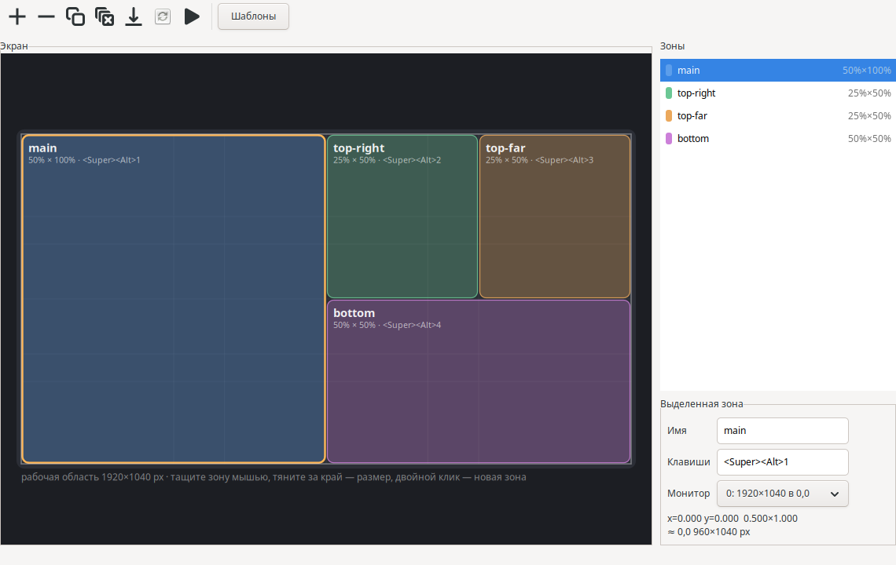
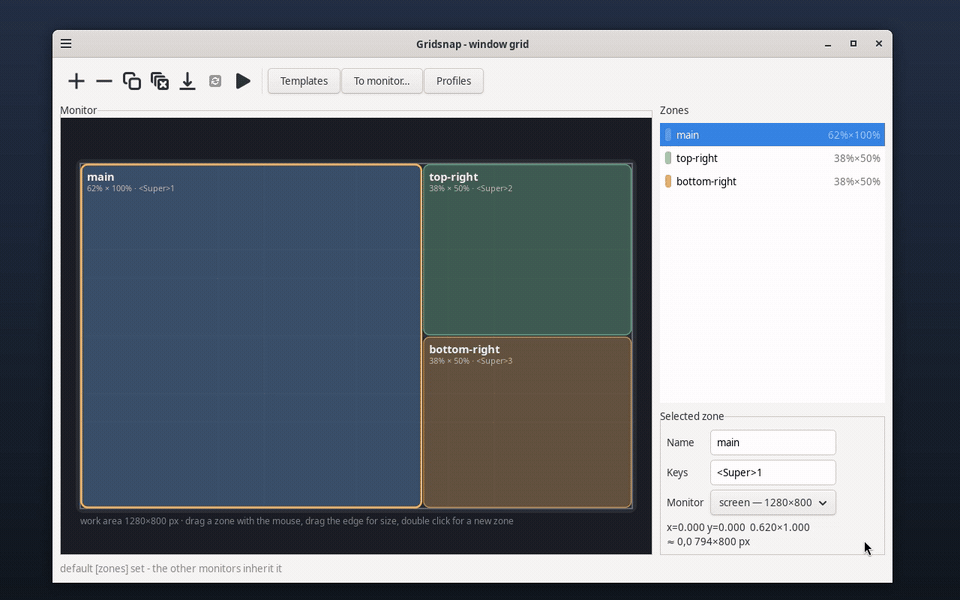

# Gridsnap —— Cinnamon 窗口网格：区域编辑器与快捷键

[English](README.md) · [**简体中文**](README.zh.md) · [Русский](README.ru.md)

本译文由机器生成，尚未经母语者校对。

已在 Debian 13、Cinnamon 6.4.10（Muffin、X11）、1920×1040 工作区上验证。

<!-- section: install -->
## 安装

<!-- translate -->

<!-- section: install-self -->
### 从仓库安装（自己用）

<!-- translate -->

<!-- section: install-package -->
### 以软件包安装

<!-- translate -->

<!-- section: install-help -->
### 参考

<!-- translate -->

<!-- section: cinnamon-native -->
## 1. Cinnamon 开箱即用的功能

<!-- translate -->

<!-- section: gtile -->
## 2. 现成的「选择单元格」网格：gTile 扩展

<!-- translate -->

<!-- section: zones -->
## 3. 自己的区域：可视化编辑器与窗口布局器

<!-- translate -->

<!-- section: zones-run -->
### 3.1. 启动编辑器

<!-- translate -->

<!-- section: zones-editor -->
### 3.2. 编辑器能做什么

<!-- translate -->

<!-- section: zones-conf -->
### 3.3. `zones.conf` 格式

<!-- translate -->

<!-- section: tiler -->
## 4. 从终端使用布局器

<!-- translate -->

<!-- section: tiler-monitors -->
### 4.1. 按屏幕的配置文件：「2 号显示器 —— 观影」（`[monitors]`）

<!-- translate -->

<!-- section: tiler-focus -->
### 4.2. 「只留这个区域」模式（`focus`）

<!-- translate -->

<!-- section: daemon -->
## 5. 守护进程：自动摆放新窗口

<!-- translate -->

<!-- section: daemon-ipc -->
### 5.1. IPC：用 `gridsnap-ctl` 控制守护进程

<!-- translate -->

<!-- section: daemon-tabs -->
### 5.2. 区域内的标签页：一个区域放多个窗口

<!-- translate -->

<!-- section: daemon-actions -->
### 5.3. 动作：把自定义命令绑到快捷键（`[action:<name>]`）

<!-- translate -->

<!-- section: hotcorners -->
## 6. 热区：把窗口拖到网格即可就位

<!-- translate -->

<!-- section: move -->
## 7. 方向键：把窗口送到相邻区域

<!-- translate -->

<!-- section: picker -->
## 8. 可视化选择区域：`Super+Z`

<!-- translate -->

<!-- section: picker-hotkey -->
### 如何在 Cinnamon 中绑定 `Super+Z`

<!-- translate -->

<!-- section: hotkeys -->
## 9. 快捷键

<!-- translate -->

<!-- section: hotkeys-focus -->
### 9.1. 用一个键切换「只留这个区域」

<!-- translate -->

<!-- section: hotkeys-profiles -->
### 9.2. 用一个键切换布局配置

<!-- translate -->

<!-- section: applet -->
## 10. Cinnamon 面板小程序：从面板使用 GridSnap

<!-- translate -->

<!-- section: troubleshooting -->
## 11. 窗口没有落到该落的地方时

<!-- translate -->

<!-- section: checks -->
## 12. 跑过的检查

<!-- translate -->
