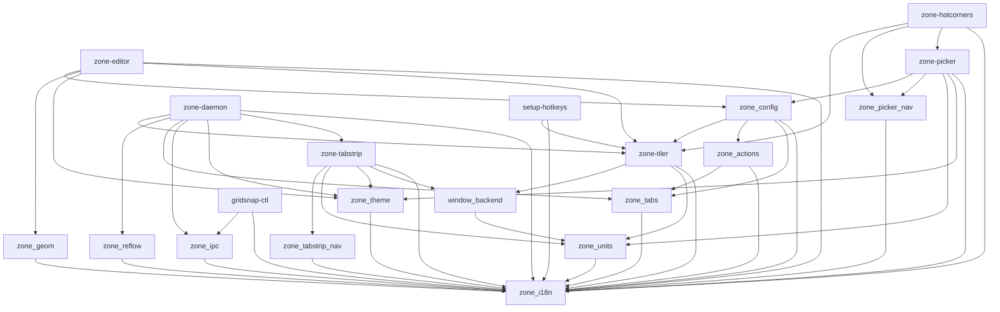

_Restored from the code during the `importing-a-codebase` pass, not yet reviewed by the owner.
Translated from the Russian draft as it was updated with the theme waves._

## Overview

GridSnap is several standalone Python executables with no shared runtime. The centre is the tiler
`zone-tiler.py`: it is the only part that knows the zone model and how to move windows. Everything
else is a wrapper around it, and the long-lived daemon `zone-daemon.py` is an optional layer
(started at login); without it every hotkey is a separate run of the tiler.

There are **two shared data units**:

* `zones.conf` — sections `[grid]`, `[zones]`, `[rules]`, `[ignore]`, `[keys]`, `[tabs]`,
  `[daemon]`, `[action:<name>]`, which every part reads and writes. A zone is a **fraction of the
  monitor work area** (0..1), not pixels. Layout profiles are separate files
  `templates/<name>.conf` (the same `[zones]`/`[rules]`/`[ignore]`/`[keys]`), which
  `zone-tiler.py profile use` copies into the active `zones.conf`.
* `theme.conf` — an optional palette next to the zone config (same INI family), read by the picker,
  the hot-corners HUD, the tab strip and the editor. Without it every surface keeps the colours it
  always drew. The contract is `docs/specs/theme.md`.

## Modules and dependencies

- **Localization `zone_i18n.py`** — chooses the interface language and finds the catalogs:
  `_()`/`translate`, `language`/`set_language`, a compiled `.mo` or `po/<language>.po` from the
  checkout. Pure: no X, no GTK, no config; every other part depends on it. Source strings are
  **English**; `ru` and `zh_CN` are catalogs on top; details in `zone-i18n`.
- **Window layer `window_backend.py`** — the only place where the product talks to the window
  system: the window list (`_NET_CLIENT_LIST`), class/title/type/desktop/minimized state, frames
  (`_NET_FRAME_EXTENTS`, `xwininfo`), monitor work areas (`GDK`, `_NET_WORKAREA`, `xrandr`) and WM
  commands through `XSendEvent` (`_NET_MOVERESIZE_WINDOW`, `_NET_WM_STATE`, `WM_CHANGE_STATE`,
  `_NET_ACTIVE_WINDOW`, `_NET_CURRENT_DESKTOP`). It pulls `zone_units` and nothing else; user-facing
  messages and exit codes stay with the CLI (a refusal is a `WindowBackendError`). Why the seam: a
  Cinnamon Wayland session would change the window layer, and while window talk is spread over the
  code every Wayland path is a rewrite (see `docs/ROADMAP.md`). During the transition
  `zone-tiler.py`/`zone-daemon.py` keep wrappers with the old names, so callers do not notice. **The
  daemon's watcher (`XSelectInput`) has not moved into this layer yet** — a separate step.
- **Tiler `zone-tiler.py`** — the grid model (`Grid`), reading `zones.conf`, computing pixel frames,
  the CLI (`list`/`apply`/`keys`/`arrange`/`stack`/`undo`/`action`). The window filters shared with
  the daemon (`window_excluded`) and the pure layout history (`History`, `choose_assignments`,
  `in_zone_rect`, `undo_targets`) live here too; reading windows and sending EWMH messages go
  through `window_backend.py`. Everything else depends on it.
- **Editor `zone-editor.py`** — a GTK window. It reads and writes the config through the pure
  `zone_config.py`, and for testing/registering keybindings it runs `zone-tiler.py` and
  `setup-hotkeys.py` as separate processes. It depends on `zone_config.py`, `zone_geom.py`,
  `zone_tiler` and `zone_theme.py`; its **Theme** menu samples the wallpaper, rewrites `theme.conf`
  and regenerates the GTK controls theme.
- **Zone picker `zone-picker.py`** — a GTK window over the monitor work area (a gTile-like overlay):
  it draws the zones, owns the keyboard, and on arrows/`Enter`/`Esc` places the active window through
  `zone-tiler.apply_zone`/`Grid.rect`. Zones come from `zone_config.load_zones`, navigation from
  `zone_picker_nav.py`, colours from `zone_theme.py`. Started by a user hotkey (`Super+Z`) as a
  separate process.
- **Picker navigation `zone_picker_nav.py`** — pure computations without GTK or X: initial
  selection, arrow movement through zone geometry (perpendicular overlap first), the zone under the
  cursor, edges, an empty list. Knows neither the config nor X; only `zone-picker.py` and the hot
  corners depend on it.
- **Units `zone_units.py`** — the single place converting GTK logical pixels to physical X ones and
  back (`physical_rect`/`logical_rect`, `physical_point`/`logical_point`, monitor scale lookup).
  Neither GTK nor X nor subcommands: the caller brings scale and frames. Project rule: zone
  arithmetic in physical pixels, logical ones only where GTK reads or sets coordinates (the picker
  overlay, the HUD, the tab strip); see `zone-units`.
- **Editor geometry `zone_geom.py`** — pure editor arithmetic without GTK or X: the "screen" scale
  on the canvas, fractions ↔ pixels, snapping, drag/resize, bounds, hit testing. Only the editor
  depends on it.
- **Config layer `zone_config.py`** — pure work with `zones.conf` without GTK: the zone model,
  loading (`load_zones`), canonical saving (`save_zones`/`save_zone_sets` — all sets in one pass,
  `[keys]` without duplicates), verbatim carriage of "foreign" sections (`[rules]`, `[ignore]`,
  `[daemon]`, …), per-monitor zone sets (`[zones:<output>]`, `load_zone_sets`), layout profiles
  (catalog, list, read/write, activation `apply_profile`), bindings — workspace → profile
  (`[workspaces]`), monitor → profile (`[monitors]`) and the shared `resolve_profile` (monitor →
  workspace → active config) used by the daemon, the tiler and the picker — and actions
  `[action:<name>]` (`load_actions`). The parser comes from the tiler
  (`zt = load_zonetiler(...)`), so it depends on `zone-tiler.py`.
- **Tabs core `zone_tabs.py`** — pure computations without X or GTK: the strip and tab-window
  frames, the "one tab — the whole zone" rule by window count (`stack_rect`), picking the windows of
  a zone by frames (`tabs_of_zone`), the switch ring (`next_tab`) and both tab protocols — the
  snapshot line for the strip (`strips_payload`) and the socket requests
  (`tabs_next_command`/`tabs_switch_command`). Frames are pixels; fractions are the caller's job.
  The daemon and the tiler depend on it; it depends on nobody.
- **Tab strip `zone-tabstrip.py`** — a GTK overlay above the top edge of a zone (`override-redirect`,
  takes no focus): reads line-by-line snapshots from stdin, draws tabs with titles, and on a click
  sends `tabs-switch` to the daemon socket. The daemon starts it and feeds it; EOF ends the process.
  Colours come from `zone_theme.py`.
- **Strip layout `zone_tabstrip_nav.py`** — pure computations without GTK or X: tab frames by strip
  width, caption clipping, click hit testing. Only `zone-tabstrip.py` depends on it.
- **Actions core `zone_actions.py`** — pure computations without X or GTK: the action context
  (`ActionContext`: window, zone, its pixel frame, monitor, workspace, class, title) and both
  channels that carry it (`GRIDSNAP_*` and the `{zone}`/`{window}`/… substitutions), command
  expansion (`expand_command`), the mirrored zone by geometry (`mirror_fractions`/`find_mirror`),
  the windows of a zone by frames (`zone_windows`) and the zone of a window (`zone_of_frame`). The
  tiler (`action`) and `zone_config` (parsing `[action:<name>]`) depend on it; it depends only on
  `zone_tabs` (frame comparison tolerance and strip height).
- **Hotkeys `setup-hotkeys.py`** — reads `zone-tiler.py keys` and writes the bindings into Cinnamon
  through `gsettings`. Depends on the tiler through its CLI.
- **Theme `zone_theme.py`** — one palette for the four drawn surfaces: loading `theme.conf`, the five
  presets, deriving zone hues from an accent, the editor's GTK sheet, sampling a wallpaper through
  GdkPixbuf (imported lazily; the module still imports without GTK), writing a marked `theme.conf`,
  and generating/refreshing the GTK controls theme. All the validation is lenient: a broken colour or
  preset keeps the default and warns on stderr, never raising into a surface that is drawing. Only
  `zone_i18n` is imported at module level.
- **Daemon `zone-daemon.py`** — the long-lived process: auto-placement of new windows by `[rules]`
  and (optionally) reflow. It resolves the grid by the window's **monitor** (`[monitors]` →
  `[workspaces]` → active config; `reload` drops the cache), so rules and zones come from that
  monitor's profile. It imports `zone-tiler.py` (`Grid`, `match_rules`, `apply_zone`, `X11`, the
  shared `window_excluded` filters), `zone_reflow.py`, `zone_tabs.py` and `zone_theme.py`; through
  `zone_ipc.py` it raises a local UNIX socket and serves client commands, and through
  `zone-tabstrip.py` it keeps the zone tabs (it is the only part that sees windows appear and close).
  It remembers placement frames in `$XDG_STATE_HOME/gridsnap/placed.json` so a window the user moved
  out is not put back. On every poll tick it also keeps a **generated** `theme.conf` and a generated
  GTK controls theme in step with the wallpaper/palette; a hand-written palette is never touched.
- **Reflow geometry `zone_reflow.py`** — the pure function `reflow(zones, freed, occupied)` without
  X11 or GTK; it knows only fractions. Only the daemon depends on it.
- **IPC `zone_ipc.py`** — the pure local UNIX-socket protocol without X or GTK: JSON-line framing
  (`LineReader`), command parsing (`parse_command`), a dispatcher with injected handlers
  (`Dispatcher`), the listening socket (`Server`). The daemon (`status`/`apply`/`reload`/`quit`) and
  `gridsnap-ctl` depend on it; it knows nothing about the config, zones or X.
- **Client `gridsnap-ctl`** — a thin wrapper over `zone_ipc.py`: builds a command from CLI arguments,
  sends it to the daemon socket, prints the JSON answer. Plain Python, no dependencies; it never
  lays out windows.
- **Installer `install-launcher.sh` + `make-icon.py`** — put a menu/desktop shortcut and icons in
  place; the shortcut points at the editor. Independent of product logic.

Dependency arrows go one way only: the editor, the zone picker, the hotkeys and the daemon know about
the tiler; the tiler does not know about them; everything that moves windows goes through
`window_backend.py`, not through X11 directly. `zone_geom.py`, `zone_picker_nav.py`,
`zone_reflow.py`, `zone_units.py` and the pure half of `zone_theme.py` are computations (editor
geometry, picker navigation, reflow, unit conversion, palette arithmetic) and know neither the config
nor X. `zone_config.py` is the pure layer between the editor/picker and the tiler.

## Decisions

- **Fractions of the work area as the zone model.** Resolution and panel change — the grid does not
  break and zones stay adjacent. The work area comes from `Gdk` (monitor workarea), and when GTK is
  unavailable from `_NET_WORKAREA` through `xprop`.
- **Placement by direct EWMH messages through `ctypes`/libX11.** It gives exact control over
  `_NET_MOVERESIZE_WINDOW` and `_NET_WM_STATE` and removes `wmctrl`/`xdotool` from the hot path.
  Maximization/fullscreen is cleared before moving, otherwise the WM restores its own geometry.
- **Window frame compensation.** The target frame is the zone; the client area gets the zone size
  minus `_NET_FRAME_EXTENTS`, so what is compared is the window frame, not the client.
- **Zone edges are computed from the same fraction lines** (`round(ww*fx)`), not as
  `x + round(ww*w)` — so neighbouring zones share a border with no pixel gap.
- **One config file, in XDG by default.** `~/.config/gridsnap/zones.conf` (honouring
  `XDG_CONFIG_HOME`); if it is missing, the `zones.conf` next to the code is used, so working
  installations do not break. `--conf PATH` overrides the choice. One file for the grid, rules,
  bindings and daemon settings.
- **A hotkey is a separate process.** Laying out by hotkey runs
  `zone-tiler.py apply <zone> --quiet`, without the daemon and without IPC.
- **The zone picker is a separate process over the work area.** `zone-picker.py` is a borderless
  window on the chosen monitor's work area with type `DOCK` (muffin keeps it on top and does not move
  it); the overlay grabs the keyboard itself (`Gdk.Seat.grab`), because a DOCK window gets no focus
  from the WM. The pure navigation lives in `zone_picker_nav.py`, so arrows and edges are testable
  without X.
- **The daemon is a separate optional process.** `zone-daemon.py` is started at login
  (`install-daemon.sh` → `~/.config/autostart/gridsnap-daemon.desktop`), places new windows by rules
  and reflows. It raises a local UNIX socket (by default `$XDG_RUNTIME_DIR/gridsnap/daemon.sock`, no
  TCP) and serves `status`/`apply`/`reload`/`quit` through the pure `zone_ipc.py`; the client is
  `gridsnap-ctl`. Framing and dispatch live in `zone_ipc.py`, so the protocol is unit-tested without
  X.
- **Per-monitor zone sets as `[zones:<output name>]`.** A monitor is addressed by its output name
  (`xrandr --list-monitors`), not by index: GDK indices change across reboots and cable replugs and
  the config would start confusing screens. The shared `[zones]` stays the default set, so an old
  `zones.conf` works as is; the section of a disconnected monitor is not deleted.
- **The window's monitor is taken by its centre.** The daemon uses the work area of the monitor the
  window is on (`read_window_center` + `monitor_for_point`) and keeps reflow inside it; zone sets are
  per monitor. Monitor 0 is no longer implied and the daemon has no `--monitor` flag.
- **Reacting to windows through `_NET_CLIENT_LIST`.** muffin reparents a client into a frame window,
  so `SubstructureNotify` on the root gives no `WM_CLASS`; the daemon listens to `PropertyNotify`
  about `_NET_CLIENT_LIST`.
- **An action is an external command, not a plugin.** An extension is an `[action:<name>]` entry: the
  tiler runs the command as a separate process and hands it the window and the zone (`GRIDSNAP_*` and
  substitutions), while four built-in actions (`builtin:`) live inside. So the tiler does not grow
  with every new operation, and foreign scripts are neither imported into its process nor tied to its
  internal API. The command runs without a shell (a title with spaces stays one argument) and without
  waiting (a terminal lives until its window closes) — see `actions`.
- **Theme is one optional palette for every surface.** The four drawn surfaces (picker overlay, HUD,
  tab strip, editor) used to carry their own float constants; they now read the same `theme.conf`
  next to the zone config. The file is INI, not TOML, because `tomllib` is Python 3.11 while Cinnamon
  ships on 3.10 (Mint 21) and an import error would take the picker down. Defaults reproduce the old
  colours, so an installation without the file is not restyled (the tab strip is the one exception:
  it shares `bg_panel`/`bg_card` with the editor and is one step darker). Validation is lenient by
  design — a typo in a colour keeps the base and warns.
- **Wallpaper sampling without `matugen`.** GdkPixbuf is already a GTK dependency and works headless:
  a 64×64 thumbnail binned at four bits per channel is a clustering already. The chrome takes the
  dominant cluster's hue at fixed lightness steps, the accent is the most vivid usable cluster, and
  the zone hues are derived from it. `matugen` is a Rust binary absent from Debian 13 and would break
  the "Python 3 + GTK 3 + libX11" promise of `SPEC.md`.
- **Generated files are marked, atomic and opt-in.** `theme.conf` written from a wallpaper starts with
  `# Generated by gridsnap …`; the daemon refreshes only a marked file whose recorded image differs,
  and the editor writes no theme unless the user asks. The GTK controls theme (`~/.themes/Gridsnap`)
  is written in the same spirit and follows the palette in place; it is selected by hand in Cinnamon
  Settings, never switched silently.
- **Interface language — one per process, from the environment.** `GRIDSNAP_LANG` beats the locale;
  `ru*` and `zh*` select the catalogs, everything else is English — the source language and the
  default. The rule lives in pure `zone_i18n.py`, because otherwise the editor, the daemon and the CLI
  would diverge; the Cinnamon applet goes the standard xlet way and uses the session locale, ignoring
  `GRIDSNAP_LANG`. Catalogs (`po/*.po` → `.mo`) are built by `make mo` and installed by every
  packaging path — see `zone-i18n`. Man pages take another path: not a domain but localized pages
  (po4a → `man/build/<language>/man1/`, English into `man1/` because it is the default language) —
  see `man-i18n`.

## Invariants

- `zone-tiler.py` imports **without GTK and without an X server**: `gi` is pulled only inside
  `monitors()` and only as the first source of the work area. That makes the tiler testable headless.
- `zone_i18n.py` is just as pure: no X, no GTK, no config. A missing catalog and a broken `.mo` are
  not errors: the source text is returned, so the interface does not depend on any file.
- `zone_theme.py` imports without GTK: GdkPixbuf and Gio are imported inside the wallpaper/GTK-theme
  functions. Loading a theme never raises into a drawing surface — a bad value warns and keeps the
  base colour.
- The tiler draws and animates nothing — it reads coordinates and sends messages.
- The editor cannot lay out windows itself: it saves the config and delegates to the tiler and the
  hotkeys.
- The product manages windows **on top of** muffin; it has no compositor or WM layer of its own.
- The daemon writes only files it generated (a marked `theme.conf`, a marked GTK theme) and never a
  hand-written palette.

## Out of scope

- A compositor or window manager of its own, browser-fingerprint spoofing and a Windows port — see
  `gridsnap`.
- A Wayland backend — not in the current code (the development idea is tracked in
  `docs/ROADMAP.md`; it does not define a spec).
- A Cinnamon shell theme (panel, menu, notifications) and Quickshell/QML widgets: Muffin does not read
  Metacity theme files at all (`meta_theme_new` is an ABI stub), and Quickshell needs Wayland with
  `wlr-layer-shell` and Hyprland's IPC. What is reachable is the GTK controls theme and the palette.
