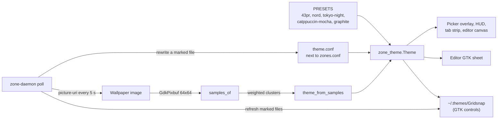
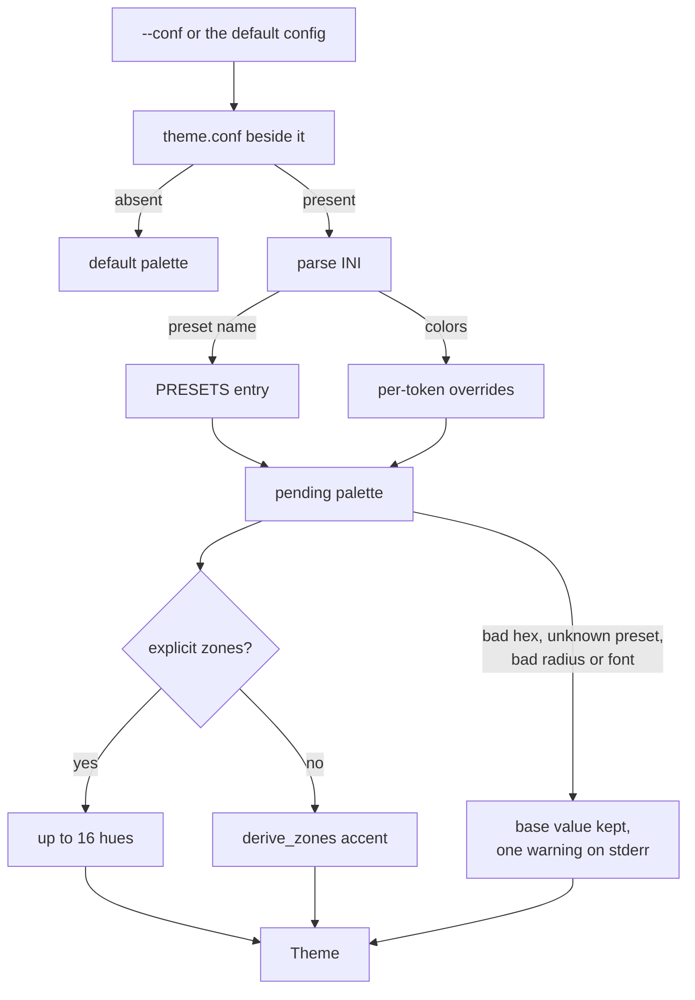

# `theme.conf` — one palette for every surface

Status: implemented on `main` (waves: palette, wallpaper, refresh, man page, GTK controls). The
module is `zone_theme.py`; the consumers are `zone-picker.py` (overlay and HUD), `zone-hotcorners.py`
(through the HUD child), `zone-tabstrip.py`, `zone-editor.py` and `zone-daemon.py` (the refresh loop).

## How a palette reaches a surface



## How the file is resolved



GridSnap draws four surfaces of its own: the interactive picker overlay, the passive HUD the hot
corners drive, the tab strip above a zone, and the editor. They used to carry their colours as
float constants, each module with its own set. One optional file now feeds all of them, so a
selection, a tab and a zone look like the same product.

## File

```
<directory of the zone config>/theme.conf
```

The zone config is `--conf` (default `~/.config/gridsnap/zones.conf`), so with a custom config the
theme follows it. There is no `--theme` flag: the theme is a property of the configuration, like the
profiles, and a second path on the command line would let the two drift apart.

The file is optional and its absence changes almost nothing: the defaults below reproduce the
colours the surfaces drew before the theme existed — the picker, the HUD and the editor are exact.
The tab strip moves one step darker, because it now shares the panel and card shades with the editor:
its strip goes `#21242b` → `#1c1f24` (`bg_panel`) and a tab `#333842` → `#2b2e36` (`bg_card`); the
active tab (`#525c70`) and the captions are unchanged. `man gridsnap` documents the file under
CONFIGURATION (`theme.conf`) and lists it under FILES. The format is INI, the same family as
`zones.conf`, and not TOML on purpose: `tomllib` arrived in Python 3.11, Cinnamon ships on
distributions with 3.10 (Mint 21), and an import error here would take the whole picker down, not
just the theme.

The `[theme]` section holds the switches (`name`, `preset`, `radius`, `font`, `zones`); the colours
live in `[colors]`, and a colour in `[theme]` is accepted too. Keys in `[DEFAULT]` are accepted as
well: configparser has no way to write a key before the first section, and a file without a palette
section is a legitimate thing to write. Unknown keys are ignored without a word — a palette file from
another project may be dropped in as is and keep its extra keys.

```ini
[theme]
preset = 43pr
radius = 10
font = JetBrains Mono

[colors]
bg       = #000000
bg_panel = #050505
bg_card  = #0d0d0d
bg_hover = #242832
fg       = #ffffff
fg_muted = #8b93a7
accent   = #ffffff
border   = #151515
danger   = #ff003c
ok       = #00ff9c
zones    = #5c9eeb, #6bc794, #eba85c, #cc80d9, #6bccd9, #eb8585, #b8c266, #9e9eeb
```

## Tokens

| Token | Meaning | Default |
|---|---|---|
| `bg` | behind everything: the overlay backdrop, the GTK window | `#12141a` |
| `bg_panel` | a panel surface: the tab strip, the editor canvas, the toolbar | `#1c1f24` |
| `bg_card` | a raised surface: a tab, the editor "screen", a button, an entry | `#2b2e36` |
| `bg_hover` | hovered or active: the active tab, a hovered button | `#525c70` |
| `fg` | main text and the work-area frame | `#ffffff` |
| `fg_muted` | captions, `.dim-label`, inactive tab titles | `#c7ccd6` |
| `accent` | the selected zone, the active tab stripe, a checked button | `#ffb554` |
| `border` | frames and separators of the GTK parts | `#525c70` |
| `danger` | reserved for destructive actions | `#eb8585` |
| `ok` | reserved for confirmations | `#6bc794` |
| `zones` | up to 16 zone hues, comma-separated; derived from `accent` when absent | the eight hues below |
| `radius` | zone corner radius in px (picker and editor) | `10` |
| `font` | Pango family for labels and tab titles | `Sans` |

The default zone hues are `#5c9eeb`, `#6bc794`, `#eba85c`, `#cc80d9`, `#6bccd9`, `#eb8585`,
`#b8c266`, `#9e9eeb` — the picker palette that predates the theme. Every default is the exact
colour the old constants produced (`(0.36, 0.62, 0.92)` is `#5c9eeb`), so an installation without
`theme.conf` does not change its look.

## Presets

| Name | Source |
|---|---|
| `43pr` | 43PR/dotfiles `default` — monochrome chrome, white accent |
| `nord` | 43PR/dotfiles `nord` |
| `tokyo-night` | 43PR/dotfiles `tokyo-night` |
| `catppuccin-mocha` | 43PR/dotfiles `catppuccin-mocha` |
| `graphite` | 43PR/dotfiles `graphite` |

The values are transcribed from [43PR/dotfiles](https://github.com/43PR/dotfiles) (MIT), including
its token names — that is the part of its design GridSnap borrows. What is **not** borrowed: the
QML shell. The bar, the side panel, the power menu and the OSDs are Quickshell widgets that need a
Wayland compositor with `wlr-layer-shell` and Hyprland's IPC; Cinnamon runs Muffin on X11 and its
own panel, so those files have no host here. A preset therefore changes colours, radius and font,
not the shape of the desktop.

`preset` is a base: `[colors]` overrides whatever it names. An unknown preset prints a warning and
keeps the default palette.

## Deriving the zone hues

Without `zones` the palette is generated from `accent`, so a theme needs one colour to make a whole
grid:

* a saturated accent starts the hue ring at its own hue;
* an accent with HSL saturation below 0.15 (the monochrome presets: `43pr` has a white accent,
  `graphite` a grey one) is replaced by hue 210°, because eight identical greys would make the grid
  unreadable;
* the ring is eight steps of 45°, at fixed lightness 0.62 and saturation 0.45 — a theme changes the
  hues and the chrome, not the contrast of a caption on a zone.

## Validation: a broken theme never breaks the desktop

Every problem keeps a usable value and prints one `zone-theme:` line on stderr. Nothing raises:

| Problem | Result |
|---|---|
| the file is missing | the defaults, silently |
| the file is unreadable or is not INI | the defaults, one warning |
| a colour is not `#RRGGBB` | that token keeps the base colour (the preset's, else the default) |
| an unknown `preset` | the default palette |
| `zones` holds a malformed entry | the entry is dropped, the rest survive |
| more than 16 zone colours | the extra ones are ignored |
| `radius` is not an integer or outside 0..64 | the default radius |
| `font` contains `,;={}[]` or is empty | the default family |

A grid that disappears because of a typo in a colour is worse than a grid in the default colours,
so the tools that draw never exit because of the theme.

## Consumers

| Surface | Tokens |
|---|---|
| picker overlay and HUD backdrop | `bg` (0.90 opaque in the overlay, `HUD_ALPHA` 0.25 in the HUD) |
| picker zone fill and outline | `zones[i]` (fill 0.20, outline 0.75) |
| picker selection | `accent` (fill 0.16, 3 px outline), corner radius `radius` |
| picker caption and hint | `accent` 0.92 for the caption, `fg` 0.72 for the hint |
| picker labels | `font` through `Theme.font_desc` |
| tab strip background / tab / active tab | `bg_panel` / `bg_card` / `bg_hover` |
| tab strip captions / accent stripe | `fg_muted` and `fg` / `accent` |
| tab strip titles | `font` at size 8 |
| editor canvas / "screen" | `bg_panel` / `bg_card` |
| editor zones and selection | `zones[i]` (fill 0.30, outline 0.85) / `accent` |
| editor guides, frame, legend | `fg` at 0.05 / 0.35 / 0.45 |
| editor labels | `font` at 11 bold and 8; legend at 9 |
| editor GTK chrome | the sheet below |

`zone-hotcorners.py` needs no change: it runs `zone-picker.py --hud --conf ...`, so the HUD picks
the theme up from the same path as the overlay.

## The editor's GTK sheet

`Theme.gtk_css()` generates the sheet the editor applies at
`GTK_STYLE_PROVIDER_PRIORITY_APPLICATION`:

* `window, window.background, .background` — `bg` / `fg`;
* `.toolbar, toolbar, .primary-toolbar, headerbar, .titlebar, .menubar, menubar, notebook,
  notebook > header` — `bg_panel`, no background image;
* `list, row, .view, treeview, scrolledwindow, viewport, viewport.frame` — `bg_panel`, no background
  image;
* `button` — `bg_card` with a `border` frame; `button.flat, button.image-button` — transparent
  (toolbar icons keep the toolbar surface); `:hover` — `bg_hover`; `:checked, :active` — `accent`
  with black or white text, whichever reads on it (relative luminance, threshold 0.35);
* `entry, spinbutton` and `textview, textview text` — `bg_card` / `fg` with no background image;
* `row:selected, list row:selected, .view:selected, *:selected` — `accent` with the contrasting text;
* `tooltip` — `bg_card` / `fg` / `border`;
* `frame, frame > border, separator, menubar > menuitem` — `border`;
* `.dim-label` — `fg_muted`.

Every selector clears `background-image` where the theme paints a gradient: a background colour
alone is invisible under one. The classes are the ones the running widgets actually carry
(`.toolbar`, `list`, `row:selected`); a type selector on its own loses to the theme's class rules.

Where the provider goes is part of the contract: a provider attached to a widget's style context
styles **that widget only**, so the real window takes the sheet on its screen (all descendants
follow), while `--shot` — a `Gtk.OffscreenWindow` that is not on any screen — gets the sheet on a
walk of the tree (`apply_theme_tree`). Without that the snapshot would show unthemed chrome and
would prove nothing.

This is not a GTK theme: it styles the editor window, not every application. A full GTK or Cinnamon
theme is a different product, and the shell parts — the panel, the menu, the notification daemon,
the window decorations — belong to Cinnamon's own theme system, which has no blur and no per-window
rounding to match the reference setup.

## The wallpaper bridge

`zone_theme.py` can build the palette from the picture behind the desktop. The editor exposes it as
**Theme → From the wallpaper…**; there is no separate command and no `--flag`, so nothing in the
CLI surface changes.

* **Resolving the image.** `wallpaper_image(value=None)` reads `picture-uri` of
  `org.cinnamon.desktop.background` (then `org.gnome.desktop.background`, for a session without the
  Cinnamon schema) unless a value is passed. A `file://` URI is decoded; a GNOME background
  descriptor (an `.xml` with `<file>` entries — Cinnamon accepts one) resolves to the first entry
  that exists. Both descriptor shapes are read: GNOME's `<file>/path.png</file>` and Debian
  desktop-base's `<file><size width=… height=…>/path.svg</size>…</file>`, where the paths are the
  text of the `<size>` children — the live Cinnamon setting on the development desktop points at
  the second kind, and its SVG loads through the GdkPixbuf SVG loader. Nothing is downloaded and no
  image is copied.
* **Sampling.** `_pixels` loads a 64×64 thumbnail through GdkPixbuf (no display needed) and drops
  fully transparent pixels; `samples_of` bins it at four bits per channel (≤4096 buckets), averages
  each bucket and returns the twelve heaviest, with their pixel counts. Deterministic: the same
  file gives the same palette.
* **Building the palette.** `theme_from_samples` takes the hue of the **dominant** cluster for the
  surface ramp (`bg` 0.05, `bg_panel` 0.09, `bg_card` 0.13, `bg_hover` 0.22 in HLS lightness, at
  ≤0.30 saturation), the most vivid cluster with lightness 0.18..0.85 as the accent (falling back
  to the lightest colour of a monochrome image), `fg` at lightness 0.93 and `fg_muted` at 0.68 in
  the accent hue, `border` at 0.28, and the zone hues from :func:`derive_zones`. `danger` and `ok`
  stay the default: they are signals, not decoration.
* **Writing.** `write_theme` writes `theme.conf` next to the config atomically, with the first line
  `# Generated by gridsnap from <image>; delete this file to return to the default palette.` The
  marker is the undo and the daemon's claim on the file (`generated_source` parses it). The editor
  reloads the theme in place (`reload_theme` reloads the one CSS provider it keeps, so palettes do
  not stack) and repaints the canvas.
* **Failures.** A missing wallpaper, an unreadable image and an image without readable colours are
  messages in the editor's status line; `from_wallpaper` raises `ValueError` and the handler turns
  it into a message. Nothing is written unless the palette was built.

## Following the wallpaper

A generated `theme.conf` does not go stale when the desktop picture changes: the running daemon
keeps it in step. `refresh_from_wallpaper(conf_path=None, path=None, wallpaper=None)` is the whole
rule; the daemon only calls it:

* **Only a generated file.** `generated_source(path)` reads the first line. Without
  `# Generated by gridsnap` there is nothing to refresh — a hand-written palette belongs to the
  user and is never overwritten, whatever the wallpaper is. A marker without a source (an older
  `write_theme` call) still counts as generated.
* **Only a different image.** The resolved image is compared with the one named by the marker
  (`os.path.abspath`, so a `file://` URI resolves to the same path). The same image — no write, and
  the file keeps its mtime; a user who edited the generated palette keeps those edits.
* **Only a readable one.** No wallpaper in the setting, a missing image file — nothing happens. An
  image that exists but cannot be sampled raises `ValueError` from `from_wallpaper`, and the old
  palette stays: a broken picture must not blank the grid.
* **Atomic, as before.** The rewrite goes through `write_theme`, so `.tmp` + `os.replace`; a picker
  launched mid-write sees one palette or the other.

The daemon polls rather than subscribes: its loop is `select()` over the X connection, the IPC
socket and the subscriber descriptors, not a GLib main loop, so a `GSettings` change signal would
never be dispatched. `serve()` waits at most `THEME_POLL_SECONDS` (5 s) and calls
`Daemon.poll_theme()` on every pass; the method throttles itself by `theme_interval`, so a burst of
X events does not read the setting each time. The check order keeps the idle cost at one file read:
the marker is inspected before the setting is touched. A failure is logged once per distinct
message, not every five seconds.

`--once` never refreshes the palette (a probe must not write the user's file), and `main` passes
`theme_interval=None` there. On a rewrite the daemon restarts the tab strip if one was running — it
reads the palette when it starts, and it is the only long-lived surface; the picker and the HUD read
`theme.conf` per launch, and the editor has **Theme → Reload theme.conf**. A generated controls theme
follows the same palette (see below).

## Window controls (GTK 3 theme)

`write_gtk_theme(directory, theme)` writes `index.theme` and `gtk-3.0/gtk.css` — a GTK theme whose
sheet imports the built-in dark Adwaita
(`resource:///org/gtk/libgtk/theme/Adwaita/gtk-contained-dark.css`) and applies the same rules as
the editor's in-app sheet, so headerbars, buttons, entries, lists and selections keep Adwaita's
behaviour but take the palette. It is written to `~/.themes/Gridsnap` (`GTK_THEME_DIR`) and must be
selected in *Cinnamon Settings → Themes → Controls*; the editor never switches a system theme
itself.

**A generated theme follows the palette.** Both files start with a marker
(`# Generated by gridsnap` / `/* Generated by gridsnap`), and `generated_gtk_theme(directory)` is
the only claim on them:

* a marked `index.theme` is ours; the unmarked file the first version wrote is adopted too
  (`Name=Gridsnap` plus a `Comment=Gridsnap controls (…)` line), so an upgrade needs no extra
  click — anything else, a theme the user wrote or copied to the same path, is never rewritten;
* `refresh_gtk_theme(conf_path, directory, theme)` renders the current palette — the passed
  `theme`, else `theme.conf` next to `conf_path`, else the defaults — and rewrites both files only
  when their text differs, so an idle poll does not churn mtimes;
* the daemon calls it on every `poll_theme` tick, *after* the wallpaper refresh, with the same
  5 s throttle; `--once` does not. The editor calls it after **From the wallpaper…** and **Reload
  theme.conf**, so the files match without a running daemon;
* deleting the directory (or the marker lines) takes the files back; the theme may stay selected in
  Cinnamon Settings, it simply stops following.

GTK 3 does not watch its theme for changes: applications already running keep the old sheet until
they restart (or the theme is re-selected in Cinnamon Settings). New applications pick the new
files up. The window decorations are still not part of this: see the finding below.

GTK 4 and libadwaita are **out of scope**: libadwaita ships its own style and does not read a
theme's `gtk-4.0` sheet for its own widgets, so a GTK 4 overlay would be a different product. The
Cinnamon 6.4 applications this desktop runs are GTK 3.

**Window borders are not themable on Cinnamon 6.4.** `libmuffin` exposes `meta_theme_new` as a
plain allocation and never opens `metacity-1/`: a metacity theme with a bright red title bar
changed nothing on a nested Muffin (`tests`-style Xvfb + `muffin` + a mapped window), and `strace`
showed no theme directory reads at all. So the decorations of server-side decorated windows stay
as Muffin draws them; only client-side decorations (the GTK theme above) and the Cinnamon shell
(its own theme) are reachable.

## Out of scope

* **Cinnamon shell theme** (`cinnamon.css`, the panel, the menu, notifications). It would repaint
  the whole desktop and would still miss the blur and vibrancy the reference design gets from
  Hyprland.
* **Quickshell/QML widgets** — no host on Muffin/X11 (see above).
* **`matugen` itself and the template fan-out of 43PR's `theme.py`** to other programs' configs.
  The wallpaper sampling above replaces `matugen` for GridSnap's own surfaces without a new
  dependency; theming other applications is a different product.
* **Metacity window borders** — not read by Muffin at all (see above).

## Verification

* `tests/test_theme.py` — defaults equal the old constants, loading and presets, every fallback,
  derivation, the GTK sheet, the wallpaper resolver (path, `file://`, GNOME descriptor, missing
  file), the sampled palette from an image made in the test (weighted samples, the surface ladder,
  a vivid accent, derived zones, a monochrome image), `theme.conf` round-trip and the marker, the
  generated-source parser (generated, source-less, hand-written, missing) and the refresh (a new
  image rewrites, the same image and a hand-written file do not, no wallpaper writes nothing, an
  unreadable image keeps the old palette), the GTK theme files and their markers, the owner test
  (marked, legacy unmarked, a user theme, absent) and the controls refresh (a new palette rewrites,
  the same palette and a user theme keep their files, the palette comes from `theme.conf`).
* `tests/test_daemon.py` — the poll is off without `theme_interval`, throttled by it, restarts the
  tab strip after a `theme.conf` rewrite, logs a failure once; the palette is written before the
  controls theme, a controls rewrite does not restart the strip, the two failures do not hide each
  other; `serve()` wakes up for the poll when X is idle and never polls in `--once` mode.
* `python3 zone-picker.py --conf <conf> --shot /tmp/picker.png` and
  `python3 zone-editor.py --conf <conf> --shot /tmp/editor.png` render the surfaces without a
  session; a `theme.conf` next to `<conf>` changes the PNG.
* The editor action is exercised end to end under Xvfb: `Editor(...).on_theme_from_wallpaper()`
  writes `theme.conf`, reloads the palette and repaints; `on_theme_controls()` writes
  `~/.themes/Gridsnap`.
* `make test`, `make check-i18n`, `tests/smoke-picker*.sh`, `tests/smoke-tabs.sh` — the drawing
  paths still run.
