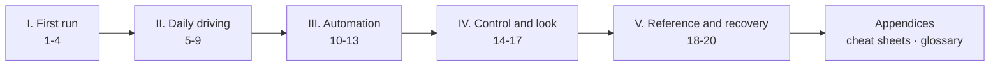

# GridSnap tutorial — outline (draft)

> **Status: skeleton, no prose yet.** This file fixes the *shape* of the tutorial: parts, chapters,
> what each chapter promises, which screenshots it needs, and how the reader proves it worked.
> Writing order and open owner decisions are at the bottom. Everything is in English per `AGENTS.md`;
> translations are a separate decision.

**Promise of the tutorial:** from “I just installed it” to “I script it and I know what breaks” in
20 chapters. Every chapter ends with a command whose output says whether the step worked — no
“should work”.

**Chapter contract** (every chapter is written to it):

1. *Goal* — one sentence, what the reader can do after it.
2. *Before* — what must already be true (files, running daemon, a second monitor…).
3. *Steps* — numbered, one action each, UI and terminal side by side where both exist.
4. *Screenshot* — the exact application state, from the inventory below.
5. *Checkpoint* — one command and the expected output (ground truth, not a promise).
6. *Pitfalls* — the two or three ways this step usually fails.
7. *Spec* — the contract behind the feature (`docs/specs/…`), for the reader who wants the rules.

## Learning path

## Part I — First run

### 1. What GridSnap is and is not
Goal: the reader knows what problem is solved and what the product will never do.
Functions: zones over Cinnamon, pixel-exact placement, desktop stays whole.
Screenshot: `01-desktop-with-zones.png` — a desktop with four labelled zones overlaid.
Checkpoint: none (orientation chapter).
Pitfalls: expecting a tiling WM; expecting a compositor; expecting Windows.
Spec: `SPEC.md` (what it is and why), `docs/product.md`.

### 2. Install and start
Goal: installed by one of the two paths, the launcher is in the menu, the daemon runs.
Functions: `install-launcher.sh` (+ `--desktop`), `install-daemon.sh` (`--list`/`--remove`),
`install.sh --prefix/--uninstall`, `make deb`/`aur`/`tarball`, version and `--help`.
Screenshot: `02-menu-launcher.png` — Cinnamon menu with the Gridsnap entry.
Checkpoint: `./gridsnap-ctl status` → `"ok": true` and the running version.
Pitfalls: launcher points at an absolute path (re-run after moving the checkout); the daemon is
optional; a reboot is not needed but a login is (XDG autostart).
Spec: `docs/specs/launcher.md`, `docs/specs/daemon.md`.

### 3. Your first window in a zone
Goal: the shipped layout is understood and one window is placed by a key.
Functions: `zone-tiler.py list`, `keys`, `apply <zone>`, `--dry-run`/`--verify`/`--quiet`;
`setup-hotkeys.py` and `--list`; `Super+Alt+1…4` of the shipped layout.
Screenshot: `03-terminal-apply.png` — `list` output next to the placed window.
Checkpoint: `python3 zone-tiler.py apply main --verify` → the frame matches the zone.
Pitfalls: app-set sizes (terminals), a zone below the 5 % minimum, hotkeys registered before the
config changed.
Spec: `docs/specs/zone-tiler.md`, `docs/specs/hotkeys.md`.

### 4. Draw your own grid
Goal: an own layout drawn, saved and bound to keys.
Functions: editor canvas, resize by edge/corner, snapping (screen edges, neighbouring zones,
1/4·1/3·1/2·2/3·3/4 lines), templates, zone names and keys, “register hotkeys” button, “apply the
active window” check button, `Ctrl+S` into `zones.conf`.
Screenshot: `04-editor-first-grid.png` — four zones with names and key hints.
Checkpoint: `python3 zone-tiler.py list` shows the new names; `apply` lands the window.
Pitfalls: zones never touch (a gap stays a gap); a zero-area zone is refused; the editor writes the
*active* config file, not a profile.
Spec: `docs/specs/zone-editor.md`, `docs/specs/zone_config.md`.

## Part II — Daily driving

### 5. Four ways to place a window
Goal: the reader picks the way that fits the moment: key, picker, drag, direction keys.
Functions: `apply` hotkeys; picker `zone-picker.py` (`Super+Z`, arrows/`Enter`/`Esc`, `--hud` with
`--at X,Y` and `--follow`, `--shot`, `--dry-run`, start zone under the cursor); hot corners/edges
(`zone-hotcorners.py`, HUD, place on drop, `--no-hud`/`--dry-run`/`--verbose`); `move
left/right/up/down` from `[move]`.
Screenshots: `05-picker-overlay.png`, `06-picker-hud.png`, `07-hotcorners-hud.png`.
Checkpoint: `python3 zone-picker.py --dry-run` opens the overlay, shows the zone under the cursor and
moves nothing; `--shot /tmp/picker.png` renders it and exits.
Pitfalls: `Super+Z` is bound by hand in Cinnamon; a window manager edge-tile fires if the HUD is
off; the picker's start zone exists only with a real pointer.
Spec: `docs/specs/zone-picker.md`, `docs/specs/zone-hotcorners.md`, `docs/specs/zone_picker_nav.md`.

### 6. Profiles: layouts as presets
Goal: “work”, “cinema”, “stream” switch with one key each.
Functions: `profile list|show|save|use|rm|export|import`; `templates/<name>.conf`; one key per
profile; editor Profiles menu (save, load as a draft, delete); gallery of eight layouts
(`profile from-gallery <id>`, editor menu).
Screenshot: `08-editor-profiles.png` — the Profiles menu open over a layout.
Checkpoint: `python3 zone-tiler.py profile list`; `profile use <name>` rewrites `[zones]`, `[rules]`,
`[keys]` and re-registers keys unless `--no-hotkeys`.
Pitfalls: `[grid]`/`[daemon]` are not touched by `use`; a loaded profile is a draft until saved;
`use` needs the daemon to notice (or a `reload`).
Spec: `docs/specs/profiles.md`, `docs/specs/zone_config.md`.

### 7. Several monitors
Goal: a different grid per output, and windows sent to another screen's zone.
Functions: `[zones:<output>]` sets, editor monitor switch, `apply --monitor <name|index>`, editor
“apply on monitor” buttons, `[monitors]` output → profile, `profile use-monitors` at login.
Screenshot: `09-two-monitors.png` — two outputs with different grids.
Checkpoint: `python3 zone-tiler.py list --monitor HDMI-1` shows that output's zones.
Pitfalls: the output name, not the number, survives a replug; the monitor binding wins over the
workspace binding.
Spec: `docs/specs/zone_config.md`, `docs/specs/profiles.md`.

### 8. One grid per desktop
Goal: every Cinnamon workspace gets its own layout.
Functions: `[workspaces]` (workspace → profile), editor “workspace profiles”, `--workspace
N|current|conf`, daemon reflow only on the visible workspace.
Screenshot: `10-editor-workspaces.png` — the workspace-profile dialog.
Checkpoint: `python3 zone-tiler.py list --workspace 0` returns the first desktop's set (or
the base layout when that desktop has no profile).
Pitfalls: a workspace without a profile falls back to the base layout; the two numberings differ —
`[workspaces]` keys use Cinnamon's (from 1), `--workspace N` uses EWMH's (from 0), and `current`
picks the active desktop's grid.
Spec: `docs/specs/zone_config.md`, `docs/specs/daemon.md`.

### 9. Tabs and focus mode
Goal: several apps in one zone, and “only this zone” on one key.
Functions: tabs (windows share the frame minus the strip), strip height `[tabs] height` (22 px),
click on the strip, `[tabs] key` → `tabs-next`, “no strip when it does not fit”; focus mode
`focus [<zone>]`, `gridsnap-ctl focus`, `[focus]` key, collapsing other windows, restoring only what
the mode collapsed, later windows joining the mode.
Screenshots: `11-tabstrip.png`, `12-focus-mode.png`.
Checkpoint: `python3 zone-tiler.py tabs-next` raises the next window of the zone.
Pitfalls: the tab set is derived from windows, nothing is stored; inactive tabs stay in place (so
Alt+Tab still lists them); the daemon is what keeps the mode alive.
Spec: `docs/specs/zone-tabs.md`.

## Part III — Automation

### 10. The daemon and `[rules]`
Goal: new windows place themselves.
Functions: daemon autostart and `--socket`/`--no-socket`; `[rules]` matching (`glob` on class,
case-insensitive, or `re:` over `class|title`), placement on the window's monitor, examples
(Chrome → `main`, Telegram → `top-right`).
Screenshot: `13-ctl-watch-events.png` — `gridsnap-ctl watch` printing `window-appeared`/`window-moved`.
Checkpoint: `gridsnap-ctl watch` prints `window-appeared` and then `window-moved` for an
app that matches a rule; `gridsnap-ctl status` lists it under `windows`.
Pitfalls: the daemon sees `_NET_CLIENT_LIST`, so a window must be mapped first; a rule matches
`WM_CLASS`, not the menu label.
Spec: `docs/specs/daemon.md`.

### 11. reflow, `[ignore]`, and windows that stay out
Goal: closing a window does not leave a hole — and the user's own arrangement is respected.
Functions: `[daemon] reflow = neighbors`, neighbour expansion and the frame restored when a window
returns; `[ignore]` selectors shared by daemon/`arrange`/`stack`/`apply`/`move`/`undo`/picker and
service window types; “pulled out of a zone — stays out” across daemon restarts
(`$XDG_STATE_HOME/gridsnap/placed.json`).
Screenshot: `14-reflow-before-after.png` — two states of the same layout.
Checkpoint: close a window in a reflow layout; the neighbour grows; re-open it and the frame returns.
Pitfalls: `reflow` is off by default; a moved window is remembered by its XID, so a re-launch is a
new window.
Spec: `docs/specs/reflow.md`, `docs/specs/daemon.md`.

### 12. Actions on a key
Goal: a key that does something with the window and its zone.
Functions: `[action:<name>]`; built-ins `minimize-others`, `show-window` (next of the stack ring),
`mirror` (geometric mirror zone), `terminal` (terminal in the zone); custom commands receiving
`GRIDSNAP_*` (window, zone, rect, monitor, workspace, class, title) and `{zone}`/`{window}`/`{x}`…
substitutions; `zone-tiler.py action <name>`; the key via `setup-hotkeys.py`.
Screenshot: `15-action-terminal.png` — a terminal opened into a zone by an action.
Checkpoint: `python3 zone-tiler.py action mirror` swaps the window with its mirror zone.
Pitfalls: third-party actions live in the active `zones.conf` and are not carried by profiles;
actions never touch ignored windows.
Spec: `docs/specs/actions.md`.

### 13. The geometry model
Goal: the reader can predict where a window lands, including HiDPI.
Functions: zones as fractions, fraction of the **physical** work area (the panel is excluded),
`zone_units.py` between logical and physical pixels, `GDK_SCALE`, 1.5 handled by output stretching,
the 5 % minimum, `_NET_FRAME_EXTENTS` compensation.
Screenshot: `16-hidpi-scales.png` — the same layout at scale 1 and 2.
Checkpoint: `python3 zone-tiler.py list` at two `GDK_SCALE` values gives one frame.
Pitfalls: app-set sizes; fractional scale on Wayland is a different model (`docs/platforms.md`);
the DPI smoke runs on Xvfb, not on real HiDPI hardware.
Spec: `docs/specs/zone-units.md`, `docs/specs/zone-tiler.md`.

## Part IV — Control and look

### 14. IPC and `gridsnap-ctl`
Goal: the reader drives the daemon from a script or a panel.
Functions: socket path and permissions; `status`, `apply`, `focus`, `reload`, `quit`, `watch`;
`subscribe` and the event names (`window-appeared`, `window-closed`, `window-moved`, `focus-on`,
`focus-off`); `arrange` delegated to the daemon while `undo` stays with the tiler; a slow subscriber
is dropped.
Screenshot: `17-ctl-status.png` — `status` JSON in a terminal.
Checkpoint: `./gridsnap-ctl status | json_pp` parses; `watch` prints one line per event.
Pitfalls: `XDG_RUNTIME_DIR` must point at the session's runtime dir; `--socket` for a second daemon.
Spec: `docs/specs/zone-ipc.md`.

### 15. The panel applet
Goal: zones and actions from the panel, without hotkeys.
Functions: applet install and enable, left/right click menus (open editor, apply keys, zone list
with `apply`, work-area summary, `arrange`, `undo`), Profiles menu, current-zone indicator, locale
from the session, its own gettext domain.
Screenshot: `18-applet-panel.png` — the panel menu open.
Checkpoint: the menu shows the zone list of the active config.
Pitfalls: it is a thin wrapper over the CLI and duplicates no logic; a moved checkout breaks it.
Spec: `docs/specs/applet.md`.

### 16. Theme
Goal: one palette across picker, HUD, tab strip and editor, optionally derived from the wallpaper.
Functions: `theme.conf` tokens and five presets; zone hues; editor Theme menu (“from wallpaper”,
“controls theme”, “reload”); a generated file marked `# Generated by gridsnap …` and refreshed by
the daemon (5 s poll, only when the source image changed); generated GTK controls theme
`~/.themes/Gridsnap` selected by hand in Cinnamon Settings; deleting the marker or the file returns
control to the user.
Screenshots: `19-editor-theme-menu.png`, `20-theme-from-wallpaper.png`.
Checkpoint: after “from wallpaper” the editor palette changes and the file carries the marker.
Pitfalls: running GTK apps keep the old controls sheet until restart; Muffin never reads Metacity
themes, so window borders stay as they are.
Spec: `docs/specs/theme.md`.

### 17. Languages and reference
Goal: the reader knows where the answer is.
Functions: `GRIDSNAP_LANG` over the locale, `ru*` → Russian, `zh*` → Chinese, everything else →
English; catalogs and `.mo`; eight man pages (`man gridsnap`, `gridsnap-tiler`, …, `gridsnap-hotcorners`)
with `en`/`ru`/`zh_CN`; `--help`/`--version` and exit codes.
Screenshot: `21-man-page.png` — `man gridsnap` in a terminal.
Checkpoint: `GRIDSNAP_LANG=zh_CN ./gridsnap-ctl --help` prints Chinese; `man gridsnap` opens.
Pitfalls: a missing catalog is not an error (source text is shown); the applet follows the session
locale and ignores `GRIDSNAP_LANG`.
Spec: `docs/specs/zone-i18n.md`, `docs/specs/man-i18n.md`.

## Part V — Reference and recovery

### 18. Files and configuration reference
Goal: the reader finds every file the product writes.
Functions: `~/.config/gridsnap/zones.conf` (live), `templates/*.conf`, `theme.conf`,
`$XDG_STATE_HOME/gridsnap/{history,placed}.json`, `$XDG_RUNTIME_DIR/gridsnap/daemon.sock`;
the shipped root `zones.conf` is only the starting layout; section cheat sheet (`[grid]`, `[zones]`,
`[zones:<output>]`, `[keys]`, `[move]`, `[focus]`, `[tabs]`, `[rules]`, `[ignore]`, `[monitors]`,
`[workspaces]`, `[daemon]`, `[action:<name>]`); the version is declared in every shipped module
that carries `VERSION = …`, plus `PKGBUILD`, the man page and `debian/changelog` (`make check-version`).
Screenshot: `22-files-map.png` — a tree of the files the product owns.
Checkpoint: `make check-version` exits 0 and says nothing — every copy agrees.
Pitfalls: editing `zones.conf` by hand requires re-running `setup-hotkeys.py`; the root `zones.conf`
is shipped, not live.
Spec: `docs/specs/zone_config.md`, `docs/specs/zone-tiler.md`.

### 19. Troubleshooting
Goal: the reader fixes the five usual failures alone.
Functions: window off by pixels (app-set size), nothing happens on a key (registration, `--list`),
the daemon is silent (`status`, `quit`, log), a window came back from a zone (rule/`[ignore]`/XID),
undo an arrangement (`undo --all`), scaling (physical vs logical area), Wayland limits.
Screenshot: `23-troubleshooting-flow.png` — a decision flow (Mermaid is enough; may stay text).
Checkpoint: `python3 zone-tiler.py undo --all` restores the previous frames.
Pitfalls: running the smokes on the live session — they raise their own displays, `:89`–`:99`.
Spec: `README.md` §11, `HANDOFF.md` “Sharp edges”.

### 20. Limits and the road ahead
Goal: the reader knows what will never work and what is next.
Functions: platform matrix (Cinnamon X11 / Cinnamon Wayland / Hyprland), Wayland-native limits, the
Cinnamon extension decision, anti-goals, the open plan items.
Screenshot: none — two tables (`docs/platforms.md`, `docs/product.md`).
Checkpoint: `docs/platforms.md` legend understood (✅/⚠️/❌, measured vs `[INFERENCE]`).
Pitfalls: treating the Hyprland column as a promise; it is an estimate.
Spec: `docs/ROADMAP.md`, `docs/platforms.md`, `docs/product.md`.

## Appendices

- **A. Command cheat sheet** — the eight executables (`zone-tiler`, `zone-daemon`, `zone-editor`,
  `zone-picker`, `zone-hotcorners`, `zone-tabstrip`, `setup-hotkeys`, `gridsnap-ctl`) and
  `install.sh`/`install-launcher.sh`/`install-daemon.sh`; one line each plus the common flags.
- **B. `zones.conf` sections** — a table of every section, its keys and its default.
- **C. Glossary** — zone, set (`[zones:<output>]`), profile, workspace profile, focus mode, tab,
  action, reflow, HUD, marker file.
- **D. Screenshot inventory and regeneration** — see below.

## Coverage checklist — every shipped function has a chapter

| Function | Chapter |
|---|---|
| Editor canvas, resize, snapping, templates | 4 |
| Zone names and keys in the editor | 4 |
| Save to `zones.conf` from the editor | 4 |
| “Register hotkeys” and “apply active window” buttons | 4 |
| Editor Profiles menu (save / load draft / delete) | 6 |
| Editor Theme menu (wallpaper, controls theme, reload) | 16 |
| `list`, `keys`, `apply` (+`--monitor`, `--dry-run`, `--verify`, `--quiet`) | 3, 7 |
| `arrange`, `stack`, `undo` | 1, 11, 19 |
| Profiles `list/show/save/use/rm/export/import`, `from-gallery` | 6 |
| `[monitors]` + `profile use-monitors` | 7 |
| `[workspaces]` + `--workspace` | 8 |
| `[zones:<output>]` per-monitor sets | 7 |
| Daemon autostart, `--socket`/`--no-socket` | 2, 10 |
| `[rules]` auto-placement | 10 |
| `reflow`, `[ignore]`, “stays out” | 11 |
| Tabs, strip, `tabs-next`, `[tabs]` | 9 |
| Focus mode, `[focus]` | 9 |
| `[action:*]`, built-ins, `GRIDSNAP_*` | 12 |
| `move left/right/up/down` | 5 |
| Hot corners/edges, HUD, flags | 5 |
| Picker `Super+Z`, `--hud`/`--at`/`--follow`, `--shot`, `--dry-run`, start zone | 5 |
| Hotkeys registration (`setup-hotkeys.py`) | 2, 3, 17 |
| IPC `status/apply/focus/reload/quit/watch/subscribe` | 14 |
| Events (`window-appeared/closed/moved`, `focus-on/off`) | 10, 14 |
| Applet menus, profiles, indicator | 15 |
| `theme.conf`, presets, zone hues | 16 |
| Palette from the wallpaper, generated file, polling | 16 |
| Generated GTK controls theme | 16 |
| `GRIDSNAP_LANG`, catalogs | 17 |
| Eight man pages, `--help`/`--version`, exit codes | 17 |
| HiDPI and the geometry model | 13 |
| Install paths, uninstall, packages | 2 |
| Files, state, socket, version duplication | 18 |
| Troubleshooting set | 19 |
| Platform matrix, limits, plan | 20 |

## Screenshot inventory

Path: `docs/images/tutorial/<nn>-<slug>.png`. **Generated by a script, never hand-saved** (the same
rule as `site/assets/*`: `tools/shoot-screens.sh`, `tools/record-demo.sh`).

| File | State to capture | Chapter |
|---|---|---|
| `01-desktop-with-zones.png` | Four labelled zones over a themed desktop | 1 |
| `02-menu-launcher.png` | Cinnamon menu, the Gridsnap entry | 2 |
| `03-terminal-apply.png` | `zone-tiler.py list` output beside a placed window | 3 |
| `04-editor-first-grid.png` | Editor, four zones with names and key hints | 4 |
| `05-picker-overlay.png` | Picker overlay, one zone highlighted | 5 |
| `06-picker-hud.png` | `--hud` passive grid | 5 |
| `07-hotcorners-hud.png` | Window dragged, HUD showing the target zone | 5 |
| `08-editor-profiles.png` | Profiles menu open over a layout | 6 |
| `09-two-monitors.png` | Two outputs, different grids | 7 |
| `10-editor-workspaces.png` | Workspace-profile dialog | 8 |
| `11-tabstrip.png` | Zone with three windows and a strip | 9 |
| `12-focus-mode.png` | One visible window, the rest collapsed | 9 |
| `13-ctl-watch-events.png` | `gridsnap-ctl watch` event lines | 10 |
| `14-reflow-before-after.png` | Same layout before/after a close | 11 |
| `15-action-terminal.png` | Terminal opened into a zone by an action | 12 |
| `16-hidpi-scales.png` | Same layout at scale 1 and 2 | 13 |
| `17-ctl-status.png` | `status` JSON | 14 |
| `18-applet-panel.png` | Panel menu open | 15 |
| `19-editor-theme-menu.png` | Theme menu open | 16 |
| `20-theme-from-wallpaper.png` | Palette derived from the wallpaper | 16 |
| `21-man-page.png` | `man gridsnap` | 17 |
| `22-files-map.png` | File tree of what the product owns | 18 |
| `23-troubleshooting-flow.png` | Failure decision flow | 19 |

Regeneration plan: a new `tools/shoot-tutorial.sh` sharing `tools/scene-palette.py` with the existing
stills (one look), its own Xvfb display outside `:0`, a keyfile `gsettings` sandbox with a temporary
`HOME` (so neither `picture-uri` nor `~/.themes/Gridsnap` is touched), and `--pin-wallpaper` where a
palette is involved. Two shots do not fit that recipe and are marked accordingly: the Cinnamon menu
and the panel applet need a real shell session — capture them manually on the owner's desktop once
and record the exact state in this table.

## Open decisions for the owner

1. **Audience and depth** — resolved for now by the owner: the first version is a **personal fast
   draft in Russian**, not committed (`.thinkrail/context/TUTORIAL-live.ru.md`, the directory is
   git-ignored), meant for a live run through every function with expected output at each step. This
   outline stays for the public English book that follows once the draft settles.
2. **Language of the book** — English only (repo rule) or the README precedent (en main page plus
   `ru`/`zh`); translation is a separate wave with its own gates.
3. **Delivery** — `docs/tutorial.md` in the repo, or three pages under `site/` next to the README
   pages; the second needs the site generator and `tests/test_site_pages.py` to learn about them.
4. **Screenshots or short GIFs** — the site already carries one demo GIF; per-chapter GIFs cost
   megabytes and a recording script each.
5. **Depth of Parts III–IV** — tutorial prose or a link to `docs/specs/` for `[rules]`, actions and
   IPC; the outline currently keeps one chapter per area.

## Writing order and gates (proposal)

1. `tools/shoot-tutorial.sh` + the inventory (images first: prose follows what is visible).
2. Parts I–II (chapters 1–9) — the daily path, the largest audience.
3. Parts III–V (10–20) and the appendices.
4. A gate of its own, `tests/test_tutorial.py`: every chapter in the coverage table exists; every
   image in the inventory exists and is a PNG (the `test_screenshots.py` trick); every checkpoint
   command is present in the corresponding `--help`; no chapter number is dangling.
5. Link the finished book from `README.md` (all three language versions) and from `docs/product.md`;
   add it to the site only if decision 3 says so.
